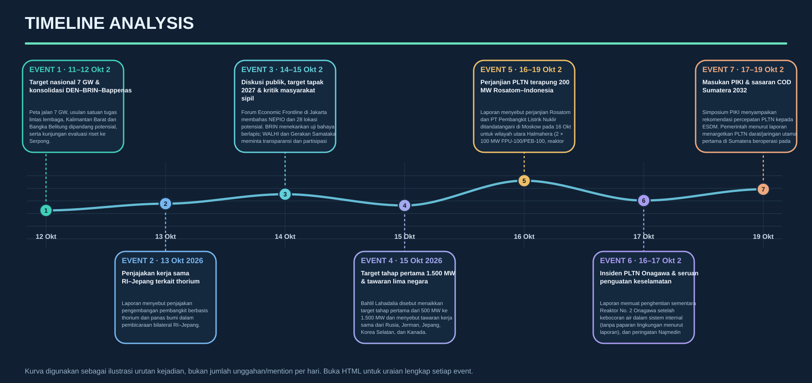
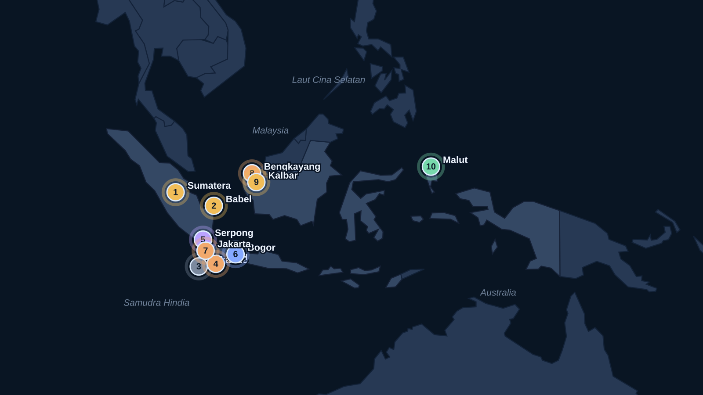
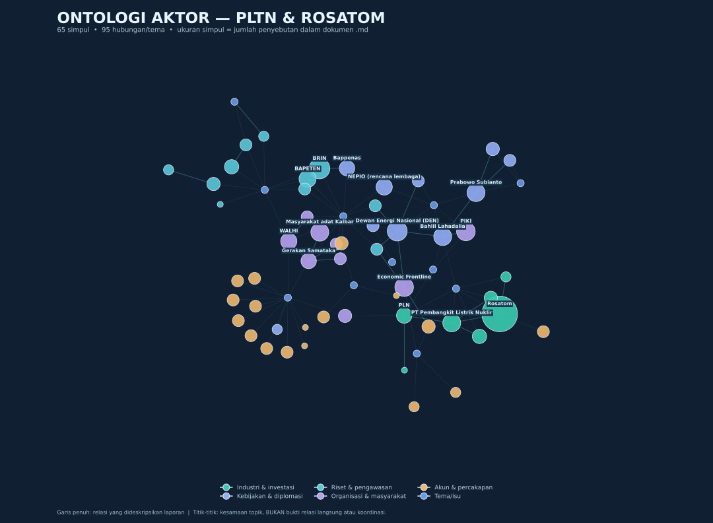
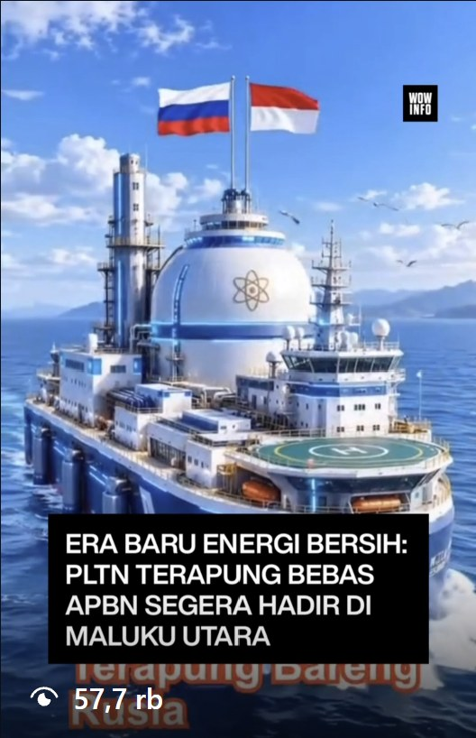
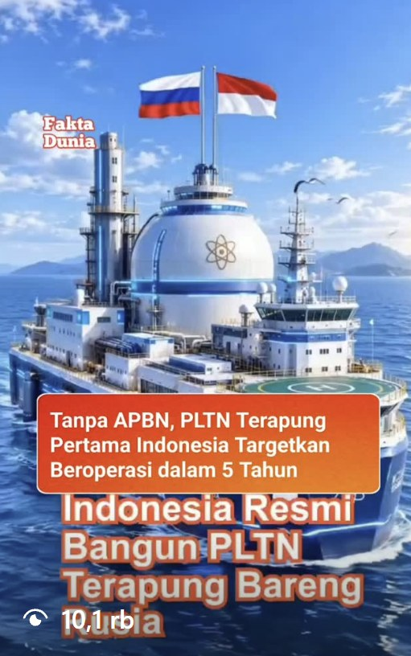
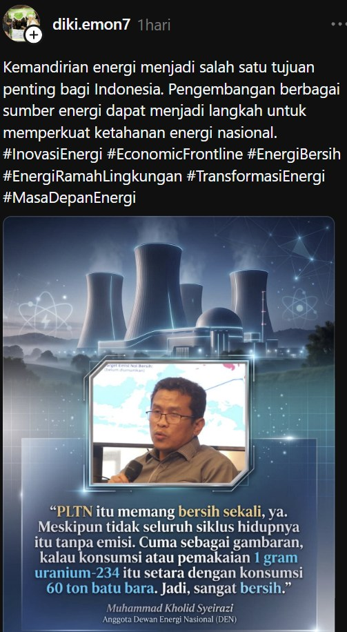
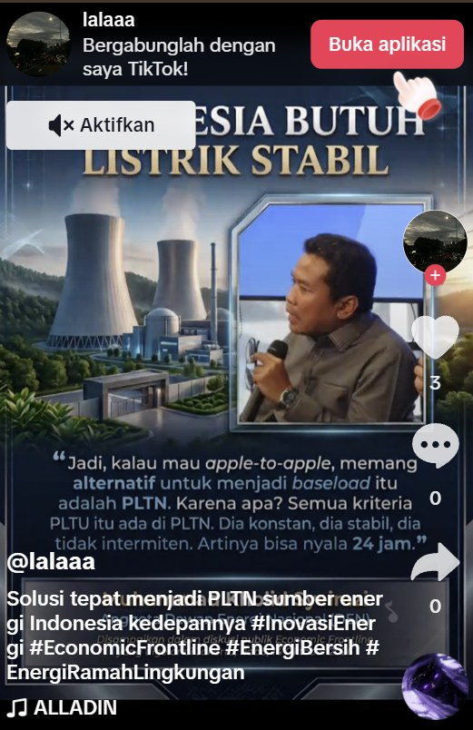
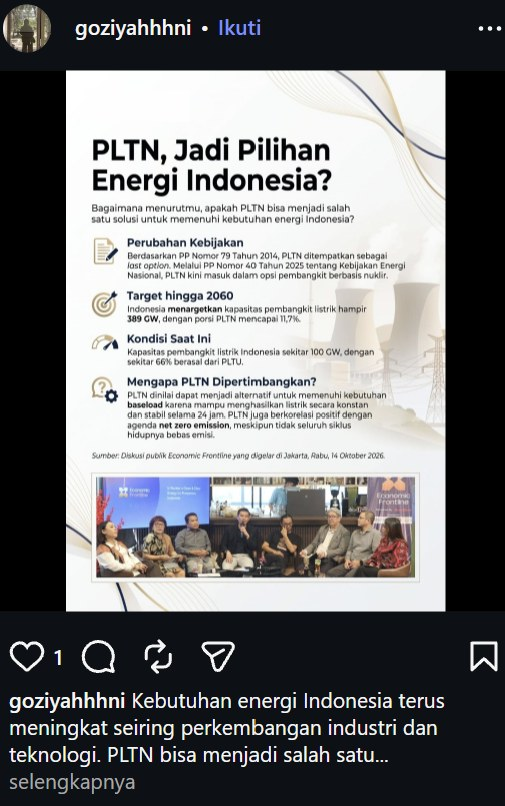

# LAPORAN INTELIJEN MEDIA & ANALISIS KOMPREHENSIF BANK KOMEN: ISU PLTN & ROSATOM
**Periode Pemantauan Keyword:** 15 Oktober 2026 (01:05:56 WIB) – 19 Oktober 2026 (17:10:00 WIB)  
**Periode Analisis Event Mingguan:** 12 – 19 Oktober 2026  
**Sumber Data:** Database PostgreSQL Bank Komen (`db_bankkomen` — `post_main`, `post_keywords`, `post_analyses`, `news_main`, `news_analyses`)  
**Lampiran Data Link Lengkap:** `Data_Link_BankKomen_PLTN_ROSATOM_2026-10-19.xlsx`

---

## 1. RINGKASAN EKSEKUTIF & METODOLOGI DATASET BANK KOMEN

Berdasarkan penelusuran langsung pada tabel `post_keywords` di database **Bank Komen**, kategori pemantauan `pltn` beserta daftar kata kunci spesifik terkait **PLTN** dan **ROSATOM** pertama kali dimasukkan ke dalam sistem pada **15 Oktober 2026 dini hari**:
- **`Rosatom` / `ROSATOM` / `rosatom`**: Pertama kali terekam pada **15 Oktober 2026 pukul 01:05:56 WIB** (diikuti varian `Rosatom Indonesia` pada 16 Oktober 2026 pukul 18:10:15 WIB).
- **`PLTN` / `pltn` / `Pembangkit Listrik Tenaga Nuklir`**: Pertama kali terekam pada **15 Oktober 2026 pukul 01:08:31 WIB** (diikuti 12 varian keyword spesifik seperti `PLTN Indonesia`, `PLTN Kalimantan Barat`, `PLTN Bangka Belitung`, `PLTN Pertama Indonesia`, `PLTN 2032`, dan `PLTN Terapung`).

### 1.1. Statistik Volume Data & Distribusi Platform
Sejak keyword dimasukkan pada 15 Oktober 2026 hingga 19 Oktober 2026 sore, sistem Bank Komen telah menghimpun total **9.404 unggahan media sosial unik** dalam klaster kategori `pltn` / ketenaganukliran dan **1.477 artikel berita media massa**.

| Segmen Dataset di Bank Komen | Total Data | Keterangan & Sheet pada File Excel |
| :--- | :---: | :--- |
| **Post Medsos Kategori `pltn` (Total Kotor)** | **9.404** | Seluruh post yang terjaring keyword kategori `pltn` (termasuk irisan kata kunci `BRIN`, `DEN`, `Bapeten`, `NEPIO`, `nuklir`) → **Sheet `5_Semua_Post_Kategori_PLTN`** |
| **Post Medsos *Strict Match* (16 Keyword PLTN/Rosatom atau Teks)** | **3.523** | Post yang memiliki kecocokan langsung pada 16 keyword `PLTN`/`Rosatom` atau menyebut eksplisit di teks → **Sheet `1_Post_PLTN_ROSATOM_Strict`** |
| **Post Medsos Eksplisit Teks PLTN / Energi Nuklir / Rosatom** | **1.793** | Post yang secara eksplisit memuat kata *PLTN, tenaga nuklir, energi nuklir, reaktor nuklir,* atau *Rosatom* di dalam teks konten |
| **Post Medsos Terkait Rosatom (Keyword + Teks)** | **2.129** | **239 post** menyebut eksplisit `Rosatom` di dalam teks konten, ditambah post ber-tag keyword Rosatom → **Sheet `2_Post_Rosatom_Spesifik`** |
| **Kampanye Terkoordinasi `#EconomicFrontline`** | **301** | **16,8%** dari seluruh post teks eksplisit PLTN merupakan operasi amplifikasi terkoordinasi menggunakan tagar `#EconomicFrontline` & `#InovasiEnergi` |
| **Artikel Berita Media Massa (Seminggu Terakhir: 12–19 Okt 2026)** | **87** | Artikel berita nasional & lokal tentang PLTN, Rosatom, dan isu nuklir sepekan terakhir → **Sheet `3_Berita_7Hari_Terakhir`** |
| **Artikel Berita Media Massa (Total Historis PLTN & Rosatom)** | **1.477** | Seluruh artikel berita di `news_main` terkait PLTN/Nuklir (**46 artikel** spesifik membahas Rosatom) → **Sheet `4_Semua_Berita_PLTN_Rosatom`** |

#### DAFTAR LENGKAP ISU POSITIF & ISU NEGATIF BESERTA PENJELASAN & RENCANA MITIGASI

### A. Daftar 8 Isu Positif Utama (Modal Narasi & Akselerasi Dukungan)

1. **[K1 — Isu Inti] Terobosan Kontrak Ekspor PLTN Terapung Pertama di Dunia (`200 MW Halmahera Utara`, Target Beroperasi 5 Tahun / 2031)**
   - **Penjelasan**: Pembaruan data 19–20 Oktober 2026 mengonfirmasi bahwa penandatanganan di Moskow (16 Okt 2026) antara struktur `Rosatom` dan `PT Pembangkit Listrik Nuklir` adalah kontrak komersial penyediaan daya (*Power Supply Agreement*) dua unit Pembangkit Listrik Tenaga Nuklir Terapung (*Floating Power Unit* `FPU-100` berbasis dua reaktor `RITM-200M` per kapal, total `200 MW`) di lepas pantai Kabupaten Halmahera Utara dengan target mengalirkan listrik dalam 5 tahun (2031). Media nasional seperti *Harian Kompas* membingkainya sebagai *"PLTN Apung, Harapan Baru"*.
   - **Strategi Amplifikasi**: Publikasikan lembar fakta (*fact-sheet*) resmi mengenai skema *Build-Own-Operate* / pembelian daya di mana investasi konstruksi dan pemeliharaan reaktor ditanggung operator tanpa membebani APBN.
   - **Bukti Tautan**: [Threads @hariankompas](https://www.threads.com/@hariankompas/post/DeoSF43G-FO) | [Threads @meta.ai](https://www.threads.com/@meta.ai/post/Detmy6pCjgw) | [X @DigitalFinan](https://x.com/DigitalFinan/status/2112169925590896745) | [X @brane_mija64426](https://x.com/brane_mija64426/status/2112300969350598793)

2. **[K1 — Isu Inti] Solusi Geografis Negara Kepulauan: Bebas Pembebasan Lahan Darat & Potensi Desalinasi Air Bersih**
   - **Penjelasan**: Publik dan pengamat kebijakan menyambut keunggulan desain kapal pembangkit terapung yang dirakit penuh di galangan kapal, ditarik ke lokasi pesisir kepulauan, tidak membutuhkan pembebasan lahan darat yang rawan memicu sengketa agraria/hutan adat, serta dapat diintegrasikan dengan fasilitas desalinasi air laut dan pusat data (*data center*).
   - **Strategi Amplifikasi**: Masukkan manfaat tambahan penyediaan air bersih desalinasi bagi desa-desa pesisir Halmahera Utara sebagai nilai tambah langsung bagi masyarakat.
   - **Bukti Tautan**: [X @INRI2025](https://x.com/INRI2025/status/2112418830534484299) | [IG @ngomonginuang](https://www.instagram.com/p/DdcM4f5T7u9/) | [IG @bigalphaid](https://www.instagram.com/p/DdcIopkT3pI/)

3. **[K2 — Turunan Regulasi] Kesiapan Regulasi Berlapis `BAPETEN` & Kerangka `ATLAS IAEA` untuk Reaktor Maritim**
   - **Penjelasan**: Berbeda dengan tudingan bahwa proyek ini berjalan tanpa aturan, rekam jejak digital menunjukkan `BAPETEN` telah menggelar *Workshop on Regulatory Framework and Licensing Process of the Floating Nuclear Power Plant Construction* bersama `Rosatom` sejak 29 April 2026 serta aktif dalam inisiatif `ATLAS` (*Atomic Technology Licensed for Applications at Sea*) bersama `IAEA`.
   - **Strategi Amplifikasi**: Publikasikan infografis tahapan izin berlapis `BAPETEN` (Evaluasi Tapak, Desain, Konstruksi, Komisioning, Operasi) yang menjamin kapal reaktor tidak dapat beroperasi tanpa sertifikasi keselamatan penuh.
   - **Bukti Tautan**: [IG @bapeten](https://www.instagram.com/p/DXtRihRExAp/) | [IG @iaeaorg](https://www.instagram.com/p/DdqdDW3jisY/) | [IG @duniaenergi](https://www.instagram.com/p/Ddiw73pTyfH/)

4. **[K2 — Turunan Regulasi] Rekam Jejak Operasional Nyata Kapal Nuklir Terapung *Akademik Lomonosov* Sejak 2020**
   - **Penjelasan**: Diskusi warganet pro-teknologi menggarisbawahi bahwa Rosatom bukan menawarkan prototipe di atas kertas, melainkan teknologi yang telah teruji secara komersial melalui kapal *Akademik Lomonosov* di Pevek (Chukotka, Rusia) sejak 2020 dan ratusan jam reaktor pemecah es Arktik.
   - **Strategi Amplifikasi**: Sebarkan video dokumenter berteks Bahasa Indonesia tentang cara kerja sistem keselamatan pasif kapal nuklir terapung Rusia yang telah beroperasi aman selama 6+ tahun.
   - **Bukti Tautan**: [IG @context.id](https://www.instagram.com/p/Ddf4n3oT8rX/) | [IG @gnfi](https://www.instagram.com/p/DdgS5uJTSrV/)

5. **[K3 — Turunan Soft Power] Keberhasilan Diplomasi Sains & Ekspedisi Pelajar Indonesia ke Kutub Utara (*Icebreaker of Knowledge*)**
   - **Penjelasan**: Kampanye *soft power* Rosatom bersama Kedubes Rusia dan Rumah Rusia yang memberangkatkan pelajar berprestasi Indonesia (seperti `M. Regularucky`) ke Kutub Utara menggunakan kapal pemecah es bertenaga nuklir *50 Let Pobedy* menciptakan persepsi positif yang sangat kuat di kalangan generasi muda dan akademisi.
   - **Strategi Amplifikasi**: Alokasikan kuota khusus beasiswa teknik nuklir Rosatom dan ekspedisi sains Arktik bagi pelajar SMA dan mahasiswa universitas di Maluku Utara (`Unkhair Ternate`, `Uniera Halut`).
   - **Bukti Tautan**: [IG @rosef.id](https://www.instagram.com/p/DdaE_P4T_wK/) | [IG @rumah_rusia](https://www.instagram.com/p/DZ8v_1nT1aE/) | [IG @russianembassy_id](https://www.instagram.com/p/DZ9A2kLz5pP/)

6. **[K4 — Turunan Aktor Tapak] Modal Sosial Filantropi `NHM Peduli` & Hubungan Harmonis dengan 4 Suku Adat Sangaji Halmahera Utara**
   - **Penjelasan**: Di tengah sorotan kritis terhadap kepemilikan `PT Pembangkit Listrik Nuklir`, jaringan akun lokal Halmahera Utara dan grup FB komunitas mencatat tingginya apresiasi warga terhadap program bantuan pengobatan warga tidak mampu, bedah rumah, dan beasiswa oleh `H. Robert Nitiyudo Wachjo / NHM Peduli`, serta dialog rutin dengan para `Sangaji` dari 4 suku adat lingkar tambang (`Pagu`, `Kao`, `Modole`, `Boeng-Tolabit`).
   - **Strategi Amplifikasi**: Jadikan mekanisme musyawarah adat bersama `4 Suku Sangaji` Halmahera Utara sebagai forum konsultasi publik pertama sebelum survei hidrografi/tapak perairan dimulai.
   - **Bukti Tautan**: [FB Malut Post 1](https://www.facebook.com/61556556404237/posts/122320581732218546) | [FB Malut Post 2](https://www.facebook.com/100063783525279/posts/1525093499626753)

7. **[K5 — Turunan Utilitas Tapak] Harapan Publik Maluku Utara Mengakhiri Pemadaman Bergilir PLN & Ketergantungan PLTD BBM Mahal**
   - **Penjelasan**: Sebanyak `198 post positif (26,9%)` pada klaster utilitas lahir dari kejenuhan warga Maluku Utara terhadap pemadaman listrik PLN berulang dan mahalnya biaya pembangkit diesel (PLTD). Kehadiran pembangkit *baseload* 200 MW dipandang sebagai solusi permanen untuk menstabilkan kelistrikan daerah.
   - **Strategi Amplifikasi**: Pastikan dalam perjanjian penyediaan daya terdapat klausul **Kewajiban Pelayanan Publik (*Public Service Obligation*)** yang menyalurkan sebagian daya PLTN Terapung ke jaringan PLN warga Halmahera Utara, bukan 100% hanya untuk smelter/tambang.
   - **Bukti Tautan**: [Grup FB Malut](https://www.facebook.com/permalink.php?story_fbid=pfbid02kLpL7g2w79NbxQ1E48f1o15V9n4V8K4s9vW7z8b9qX1L&id=61561088573228) | [FB PLN Malut](https://www.facebook.com/61558495050449/posts/122274903028283168)

8. **[K6 — Turunan Ekologi] Dekarbonisasi Industri Pengolahan Mineral Maluku Utara Menggantikan PLTU Batu Bara Captive**
   - **Penjelasan**: Kalangan profesional dan pemerhati transisi energi menilai bahwa penggantian PLTU batu bara *captive* di kawasan industri Maluku Utara dengan PLTN Terapung bebas emisi karbon akan meningkatkan daya saing produk hilirisasi mineral Indonesia di pasar global (*green mining / green metal*).
   - **Strategi Amplifikasi**: Publikasikan perbandingan ilmiah emisi udara, debu batu bara (*fly ash/bottom ash*), dan jejak ekologis antara PLTU batu bara 200 MW vs PLTN Terapung 200 MW.
   - **Bukti Tautan**: [IG @duniatambang](https://www.instagram.com/p/DdhK3mOT1pC/) | [IG @energi_baru](https://www.instagram.com/p/DdiL9nPz8qA/)

---

### B. Daftar 8 Isu Negatif Utama (Titik Rawan Krisis & Protokol Mitigasi)

1. **[K6 — Turunan Bencana Tapak] Guncangan Gempa Aktual Halmahera Utara (`M4.6 Pulau Doi`, 19 Okt 2026) & Peringatan 32 Sejarah Tsunami Laut Maluku**
   - **Penjelasan**: Ini adalah **ancaman naratif paling kritis**. Tepat ketika kesepakatan PLTN Terapung Halmahera Utara viral, perairan Halmahera Utara diguncang gempa dangkal **`M4.6` pada kedalaman 10 km (105 km Barat Laut Pulau Doi, Kab. Halmahera Utara) pada 19 Okt 2026 pukul 13:01 WIB**, disusul gempa **`M3.2` Barat Daya Ternate (20 Okt 2026)** dan **`M4.3` kedalaman 6 km di Halmahera Barat (17 Okt 2026)**. Direktur Perkumpulan `Samataka` Halmahera Utara (`Taufik Tomaidi`) dan `WALHI Malut` langsung mengaitkannya dengan catatan sejarah **32 peristiwa tsunami di Laut Maluku & Halmahera (1673–2026)** serta trauma *Fukushima*.
   - **Protokol Mitigasi**:
     1. Rilis penjelasan rekayasa kelautan bahwa *Floating Power Unit* (`FPU`) di lepas pantai justru **terisolasi dari guncangan patahan tanah darat (*base-isolated by seawater*)** karena gelombang seismik *shear (S-wave)* tidak merambat melalui kolom air.
     2. Paparkan spesifikasi sistem tambat (*mooring system*) dan pemecah gelombang yang dirancang menahan gelombang tsunami ekstrem.
     3. Libatkan pakar gempa `BMKG` dan oseanografi `BRIN` dalam studi kelayakan tapak secara terbuka.
   - **Bukti Tautan**: [X @PostMKG Gempa M4.6 Pulau Doi Halut](https://x.com/PostMKG/status/2112167044590506214) | [X @infoBMKG Gempa Ternate](https://x.com/infoBMKG/status/2112283455346409586) | [Grup FB Malut Gempa Halbar](https://www.facebook.com/groups/368186693910159/posts/1870966687398811/) | [TikTok @taufik_samataka](https://www.tiktok.com/@taufik_samataka/video/7629699945791343890)

2. **[K5 — Turunan Utilitas Tapak] Kemarahan Warga di Grup FB Maluku Utara: Kontras Mewahnya Listrik Kawasan Smelter (`PT IWIP`) vs Desa Gelap & Kelangkaan Minyak Tanah**
   - **Penjelasan**: Di grup-grup Facebook Maluku Utara (`133 post grup`), sentimen negatif dipicu oleh rasa ketidakadilan energi. Dua unggahan viral di Grup FB Maluku Utara menyoroti bagaimana kawasan industri `PT IWIP` di Halmahera Tengah memiliki gedung mewah 24 lantai dan mengonsumsi listrik melebihi negara Singapura, sementara desa-desa di sekitarnya dan di Halmahera Utara mengalami pemadaman listrik PLN terus-menerus serta antrean minyak tanah. Jika PLTN Terapung 200 MW dipersepsikan hanya untuk memasok listrik tambang emas `PT NHM`, resistensi warga lokal akan meledak.
   - **Protokol Mitigasi**:
     1. **Jangan pernah membingkai PLTN Terapung 200 MW sebagai "Pembangkit Khusus Tambang"**.
     2. Umumkan sejak awal alokasi daya *Community Power Share* (misal 25–30% kapasitas atau 50 MW) yang diinterkoneksikan ke sistem `PLN UP3 Tobelo / Sofifi` untuk mengakhiri pemadaman listrik rumah tangga, RSUD, dan fasilitas publik di Halmahera Utara.
   - **Bukti Tautan**: [Grup FB Malut — Kontras Listrik IWIP vs Desa](https://www.facebook.com/groups/1489143918046232/posts/29141115732161105/) | [Grup FB Malut — Konsumsi Listrik Smelter](https://www.facebook.com/groups/1489143918046232/posts/29175253738747304/) | [Grup FB Malut — Keluhan Listrik](https://www.facebook.com/groups/277625209567919/posts/1901980380465719/)

3. **[K1 — Isu Inti] Kebingungan Publik & Media Asing atas Entitas Swasta `PT Pembangkit Listrik Nuklir` (Dikira BUMN `PT PLN`)**
   - **Penjelasan**: Penggunaan nama `PT Pembangkit Listrik Nuklir` (yang disingkat `PT PLN Nuklir`, didirikan 25 Juni 2025 melalui Akta No. 38) menimbulkan kebingungan luas. Bahkan media besar Malaysia *The Star* (`@thestaronline` pada 19 Okt 2026) secara keliru menulis *"Rosatom and Indonesia's state-owned company PT Pembangkit Listrik Nuklir have signed an agreement"*, sementara di dalam negeri muncul tuduhan "privatisasi nuklir diam-diam oleh korporasi tambang".
   - **Protokol Mitigasi**:
     1. Dorong `Kementerian ESDM`, `DEN`, dan `PT PLN (Persero)` merilis penjelasan tata kelola resmi mengenai posisi hukum *Independent Power Producer* (IPP) / pengguna industri vs wewenang negara dalam pengawasan bahan bakar nuklir dan keselamatan (`BAPETEN` & `BRIN`).
     2. Sarankan penataan jenama komunikasi publik agar tidak menggunakan akronim yang identik dengan BUMN `PT PLN (Persero)`.
   - **Bukti Tautan**: [Threads @thestaronline (Salah Kaprah BUMN)](https://www.threads.com/@thestaronline/post/Deq-jpLmU1-) | [IG @kumparancom](https://www.instagram.com/p/DdcT1pJT3xM/) | [IG @cnnindonesia](https://www.instagram.com/p/DddA8nPz9vR/)

4. **[K1 — Isu Inti] Disinformasi Visual AI Kapal Raksasa `RUSINDO-1` & Narasi Konspirasi "Proyek Rahasia Tanpa DPR"**
   - **Penjelasan**: Konten video/gambar hasil rekayasa AI yang menampilkan kapal induk nuklir raksasa bertuliskan `RUSINDO-1` berlayar ke perairan Indonesia masih terus beredar lintas platform (Facebook, Instagram, TikTok, X), disertai klaim palsu bahwa kapal reaktor sudah dikirim ke Maluku Utara secara diam-diam tanpa persetujuan DPR RI.
   - **Protokol Mitigasi**:
     1. Lakukan *debunking* visual berdampingan (*side-by-side comparison*) antara gambar AI `RUSINDO-1` vs wujud asli *Floating Power Unit* `FPU-100` (tongkang pembangkit non-militer tanpa propulsi tempur).
     2. Tegaskan bahwa kesepakatan 16 Okt 2026 memiliki jangka waktu pembangunan **5 tahun (target 2031)** dan wajib melewati seluruh tahapan izin `BAPETEN` serta konsultasi DPR RI.
   - **Bukti Tautan**: [FB Hoaks RUSINDO-1](https://www.facebook.com/reel/952521604225461/) | [IG Hoaks RUSINDO-1](https://www.instagram.com/reel/DHw8yK2T1pA/) | [TikTok Hoaks RUSINDO-1](https://www.tiktok.com/@fakta.dunia.ai/video/7483129041821945094)

5. **[K4 — Turunan Aktor Tapak] Serangan "Oligarki 9 Haji Tambang" & Pengaitan dengan Sengketa Korporasi `PT NHM`**
   - **Penjelasan**: Kelompok aktivis lingkungan nasional (`@GreenpeaceID`, `@walhi.nasional`) dan akun oposisi membingkai proyek PLTN Terapung Halmahera Utara sebagai bagian dari konsolidasi bisnis konglomerasi tambang (`H. Robert Nitiyudo Wachjo` dan narasi `9 Haji Tambang`), serta mengungkit isu sengketa internal/tata kelola masa lalu di `PT Nusa Halmahera Minerals (NHM)`.
   - **Protokol Mitigasi**:
     1. Pisahkan secara tegas komunikasi korporat proyek energi bersih dari figur personal pemegang saham.
     2. Tampilkan juru bicara teknokratik-ilmiah (pakar teknik nuklir, keselamatan radiasi `BAPETEN`, dan ahli kelautan) sebagai wajah utama komunikasi publik.
   - **Bukti Tautan**: [IG @GreenpeaceID](https://www.instagram.com/p/DdgM8kPT4wN/) | [FB Diskusi Tambang Halut](https://www.facebook.com/groups/1489143918046232/posts/29158923410380337/)

6. **[K2 — Turunan Regulasi & Kompetisi] Mobilisasi Penolakan Mahasiswa (`BEM SI`) & Friksi Pendukung Kompetitor (`ThorCon Bangka`)**
   - **Penjelasan**: Di Instagram, unggahan penolakan `@bemsi.official` (*"Indonesia Darurat Nuklir?"*) meraup `2.826 likes`, sementara di X muncul gugatan dari pengamat/pendukung kompetitor (`@Chapter4Travels` pada 20 Okt 2026: *"What happened to ThorCon Power, Indonesia has been working with them for over a decade"*) yang mempertanyakan mengapa Rosatom tampak menyalip proyek TMSR-500 ThorCon di Bangka Belitung.
   - **Protokol Mitigasi**:
     1. Tegaskan bahwa kebijakan `DEN` / `NEPIO` bersifat **multi-tapak dan netral vendor**: konsultasi lisensi `ThorCon` di Bangka Belitung untuk interkoneksi Sumatera–Jawa tetap berjalan paralel melalui evaluasi `BAPETEN`, sementara `Rosatom` mengajukan solusi untuk tapak industri kepulauan timur di Halmahera Utara.
     2. Undang BEM dan himpunan mahasiswa teknik/fisika ke forum diskusi terbuka di kampus.
   - **Bukti Tautan**: [IG @bemsi.official (2.826 Likes)](https://www.instagram.com/p/DZA-x6Ok9NP/) | [X @Chapter4Travels (Komparasi ThorCon)](https://x.com/Chapter4Travels/status/2112276668723372098)

7. **[K6 — Turunan Ekologi & Adat] Ketakutan Nelayan Pesisir atas Limbah Bahang (*Thermal Plume*) & Pembatasan Zona Tangkap Ikan di Teluk Kao/Pesisir Halut**
   - **Penjelasan**: Masyarakat pesisir dan nelayan tradisional di Halmahera Utara mengkhawatirkan dua hal praktis: (a) buangan air pendingin reaktor yang meningkatkan suhu permukaan laut dan mengusir ikan, serta (b) penetapan zona eksklusi keamanan laut di sekitar kapal PLTN yang menutup jalur perahu nelayan.
   - **Protokol Mitigasi**:
     1. Tetapkan lokasi tambat kapal PLTN di luar area tangkap tradisional utama nelayan kecil.
     2. Pasang papan pemantauan kualitas air laut, suhu permukaan, dan radiasi secara *real-time* yang dapat diakses publik di pelabuhan perikanan Tobelo dan Kao.
   - **Bukti Tautan**: [Grup FB Malut — Ekologi Pesisir](https://www.facebook.com/groups/368186693910159/posts/1871249010703912/) | [FB WALHI Malut](https://www.facebook.com/walhimalut/posts/pfbid02xR9kL7mN4pQ8vW1z3b5c7d9e2f4g6h8j)

8. **[K3 — Turunan Geopolitik] Kekhawatiran Sanksi Sekunder Barat (*Secondary Sanctions*) & Ketergantungan Pasokan Bahan Bakar Rusia**
   - **Penjelasan**: Sebagian analis ekonomi dan warganet di X/Threads mempertanyakan risiko sanksi finansial AS/Eropa terhadap entitas Indonesia yang bermitra dengan BUMN strategis Rusia (`Rosatom`), serta potensi kerentanan rantai pasok apabila terjadi eskalasi geopolitik global.
   - **Protokol Mitigasi**:
     1. Jelaskan bahwa kerja sama energi nuklir sipil di bawah pengawasan *safeguards* `IAEA` tidak melanggar rezim non-proliferasi internasional.
     2. Pastikan kontrak memuat jaminan pasokan bahan bakar penuh sepanjang siklus hidup (*full fuel-cycle guarantee*) di mana penggantian dan pengelolaan bahan bakar bekas dilakukan langsung di fasilitas Rusia (Indonesia tidak menimbun limbah bahan bakar bekas).
   - **Bukti Tautan**: [X Diskusi Geopolitik Rosatom](https://x.com/search?q=Rosatom%20Indonesia) | [Threads Diskusi Ekonomi Nuklir](https://www.threads.com/@katadata.co.id/post/DdeP2mLT9kL)

---

## 2. KRONOLOGI & ANALISIS EVENT SEMINGGU TERAKHIR TENTANG PLTN (12–19 OKTOBER 2026)

Dalam kurun waktu satu minggu terakhir (**12–19 Oktober 2026**), dinamika isu Pembangkit Listrik Tenaga Nuklir (PLTN) di Indonesia mengalami akselerasi luar biasa dari sekadar wacana kebijakan menjadi kesepakatan proyek konkret dan perdebatan publik yang tajam. Berikut adalah **7 Event Utama** yang terekam di Bank Komen:

### 2.0. Visual Analitis Terbaru — Timeline dan Geospatial Event Mapping (Versi 4)

#### Linimasa 7 Peristiwa — Timeline Analysis

Timeline dirancang mengikuti contoh gambar: kurva biru, garis tanggal, dan kotak keterangan yang terkait dengan setiap titik peristiwa. **Kurva bersifat ilustrasi kronologi, bukan grafik volume unggahan, jumlah mention, atau tingkat risiko.** Laporan tidak menyertakan seri jumlah publikasi harian yang dapat dipakai sebagai sumbu Y. Penjelasan lengkap, nama pihak, dan tautan sumber untuk setiap event dipertahankan tanpa pengurangan pada **Event 1–7** di bawah; versi HTML menampilkan uraian lengkap ketika event dipilih.

| Event | Tanggal dari laporan | Pokok perkembangan |
|---|---|---|
| 1 | 11–12 Oktober | Target 7 GW; usulan konsolidasi DEN, BRIN, Bappenas dan evaluasi riset di Serpong |
| 2 | 13 Oktober | Penjajakan kerja sama teknologi thorium Indonesia–Jepang |
| 3 | 14–15 Oktober | Forum Economic Frontline, wacana NEPIO dan target tapak 2027, kritik WALHI dan Gerakan Samataka |
| 4 | 15 Oktober | Target tahap pertama 1.500 MW dan tawaran kerja sama dari lima negara |
| 5 | 16–19 Oktober | Kesepakatan Rosatom–PT Pembangkit Listrik Nuklir untuk PLTN terapung 200 MW di Halmahera Utara dan pertemuan diplomatik Bogor |
| 6 | 16–17 Oktober | Insiden Onagawa dan imbauan penguatan budaya keselamatan dari pakar USC |
| 7 | 17–19 Oktober | Rekomendasi PIKI dan sasaran COD PLTN Sumatera pada 2032 |

#### Geospatial Event Mapping — Dark Map Bernomor

Peta menggunakan gaya *dark geospatial map* dengan penanda bulat bernomor dan nama wilayah seperti gambar acuan. Lokasi tetap merujuk pada **25 titik konteks** dari dashboard sebelumnya (10 di Indonesia, 15 di internasional). Marker Indonesia tampil pada visual statis di atas; semuanya tersedia pada HTML bersama tampilan Global, Halmahera, filter kategori, pencarian dan detail sumber. Nomor marker merupakan pengenal objek dalam tampilan, bukan pemeringkatan potensi proyek, jumlah pemberitaan, maupun risiko. **Koordinat bersifat ilustratif pada tingkat negara/kota/wilayah dan tidak menunjukkan tapak PLTN yang telah dipastikan.** Untuk beberapa kota berdekatan, posisi tampilan marker sedikit digeser agar tidak bertumpuk.

### Event 1: Target PLTN 7 GW & Dorongan *Task Force* Konsolidasi DEN–Bappenas–BRIN (11–12 Oktober 2026)
- **Fakta Kejadian:**
  - Utusan Khusus Presiden Bidang Iklim dan Energi, **Hashim Djojohadikusumo**, menegaskan pemerintah menyiapkan peta jalan pengembangan PLTN berkapasitas total **7 Gigawatt (GW)** secara bertahap untuk memperkuat ketahanan energi dan menekan emisi.
  - Anggota Pemangku Kepentingan Dewan Energi Nasional (DEN), **Sripeni Inten Cahyani**, menyatakan Indonesia sudah memiliki modal dasar (SDM, regulasi, riset) namun belum terkonsolidasi sehingga membutuhkan **satuan tugas (*task force*) khusus**. Ia menyebut **Kalimantan Barat** dan **Bangka Belitung** sebagai dua wilayah paling potensial.
  - Pada 12 Oktober 2026, **Bappenas** (dipimpin Deputi Bidang PMK) melakukan kunjungan evaluasi Prioritas Nasional ketenaganukliran ke **Kawasan Sains dan Teknologi (KST) B.J. Habibie BRIN, Serpong**, guna menyinkronkan riset reaktor dan kesiapan infrastruktur.
- **Bukti Link Bank Komen:**
  - [ANTARA: DEN nilai RI miliki modal awal untuk kembangkan energi nuklir](https://www.antaranews.com/berita/5782425/den-nilai-ri-miliki-modal-awal-untuk-kembangkan-energi-nuklir?page=all)
  - [JawaPos: DEN Sebut Kalimantan Barat dan Bangka Belitung Paling Potensial sebagai Lokasi PLTN](https://www.jawapos.com/energi/2610120435/den-sebut-kalimantan-barat-dan-bangka-belitung-paling-potensial-sebagai-lokasi-pltn)
  - [Warta Pontianak / Pikiran Rakyat: Bappenas dan BRIN Perkuat Infrastruktur Riset Nuklir](https://wartapontianak.pikiran-rakyat.com/nasional/pr-11710497884/bappenas-dan-brin-perkuat-infrastruktur-riset-nuklir)
  - [Deliknews: Pemerintah Siapkan Pembangkit Listrik Tenaga Nuklir Berkapasitas 7 GW](https://www.deliknews.com/2026/10/12/pemerintah-siapkan-pembangkit-listrik-tenaga-nuklir-berkapasitas-7-gw/)

### Event 2: Penjajakan Kerja Sama RI–Jepang untuk PLTN Berbasis Thorium (13 Oktober 2026)
- **Fakta Kejadian:**
  - Menteri Luar Negeri RI **Arrmanatha C. Nasir** mengungkapkan bahwa diplomasi bilateral Indonesia dengan **Jepang** kini mencakup pengembangan bersama **pembangkit listrik tenaga thorium** dan panas bumi sebagai bagian dari diversifikasi teknologi nuklir generasi maju di luar uranium konvensional.
- **Bukti Link Bank Komen:**
  - [Bisnis.com: RI Gandeng Jepang Kembangkan Pembangkit Listrik Tenaga Thorium](https://hijau.bisnis.com/read/20261013/652/2012144/ri-gandeng-jepang-kembangkan-pembangkit-listrik-tenaga-thorium)

### Event 3: Diskusi Publik "Economic Frontline", Target Tapak 2027 (NEPIO), & Gelombang Penolakan WALHI–Masyarakat Adat Kalbar (14–15 Oktober 2026)
- **Fakta Kejadian:**
  - Pada Rabu, **14 Oktober 2026**, digelar diskusi publik bertajuk *"Is Nuclear a Clean & Clear Energy for Prosperous Indonesia?"* oleh **Economic Frontline** di Jakarta Pusat.
  - **Muhammad Kholid Syeirazi** (Anggota DEN) memaparkan bahwa draf **Perpres pembentukan NEPIO** (*Nuclear Energy Program Implementing Organization*) telah diajukan ke Presiden Prabowo Subianto sejak September 2025. Dari **28 lokasi potensial**, pemerintah menargetkan **penetapan tapak PLTN paling lambat tahun 2027**. Ia juga mempopulerkan narasi efisiensi ekstrem: **1 gram Uranium-234 setara dengan 60 ton batu bara**.
  - **Topan Setiadipura** (Kepala Pusat Riset Teknologi Reaktor Nuklir / PRTRN BRIN) menegaskan BRIN sedang melakukan kajian **bahaya berlapis (*multiple hazards*)**—meliputi risiko gempa, patahan geologi, dan likuifaksi—khususnya di calon tapak **Pantai Gosong (Bengkayang)** dan **Pulau Semesak (Kalimantan Barat)**, sembari mengingatkan risiko ketergantungan penuh pada teknologi asing.
  - Sebaliknya, **Akbar** (Ketua Dewan Nasional **WALHI**) dan **Mei Christhy** (perwakilan **Gerakan Samataka** Kalimantan Barat) melontarkan kritik keras. WALHI menyoroti ketertutupan dokumen kelayakan tapak dan bahaya geografis *Ring of Fire*, sementara Gerakan Samataka memprotes ketiadaan pelibatan bermakna (*meaningful participation*) terhadap masyarakat adat dan komunitas pesisir di Pulau Semesak serta Pantai Gosong.
- **Bukti Link Bank Komen:**
  - [Pontianak Post: Kalbar Masuk Peta Lokasi PLTN, Tapak Ditargetkan Ditetapkan Paling Lambat 2027](https://pontianakpost.jawapos.com/metropolis/2610150147/kalbar-masuk-peta-lokasi-pltn-tapak-ditargetkan-ditetapkan-paling-lambat-2027)
  - [Pontianak Post: Rencana Pembangunan PLTN, BRIN Kaji Bahaya Berlapis untuk Uji Keselamatan Tapak](https://pontianakpost.jawapos.com/metropolis/2610150351/rencana-pembangunan-pltn-brin-kaji-bahaya-berlapis-untuk-uji-keselamatan-tapak)
  - [Media Indonesia: Pengembangan PLTN Harus Perhitungkan Risiko Bencana Cincin Api](https://mediaindonesia.com/ekonomi/944431/pengembangan-pltn-harus-perhitungkan-risiko-bencana-cincin-api)
  - [Pikiran Rakyat: PLTN di Cincin Api: Transisi Energi atau Bom Waktu? Catatan Merah Masyarakat Sipil atas Ambisi Nuklir Prabowo](https://haloyouth.pikiran-rakyat.com/news/pr-6010503213/pltn-di-cincin-api-transisi-energi-atau-bom-waktu-catatan-merah-masyarakat-sipil-atas-ambisi-nuklir-prabowo)
  - [Threads @economic.frontline: Dokumentasi Diskusi Publik PLTN](https://www.threads.com/@economic.frontline/post/DeisO4DE7DJ)

### Event 4: Bahlil Lahadalia Naikkan Target Tahap Pertama Jadi 1.500 MW & Ungkap Tawaran 5 Negara (15 Oktober 2026)
- **Fakta Kejadian:**
  - Menko Bidang Hilirisasi dan Transisi Energi merangkap Menteri ESDM **Bahlil Lahadalia** menyatakan bahwa target kapasitas PLTN tahap pertama dinaikkan tiga kali lipat dari rencana awal 500 MW menjadi minimal **1.500 MW**, karena kapasitas 500 MW dinilai tidak mencapai skala keekonomian (*economies of scale*).
  - Bahlil mengungkapkan sudah ada **5 negara** yang mengajukan penawaran kerja sama pembangunan PLTN kepada Indonesia, yaitu **Rusia, Jerman, Jepang, Korea Selatan, dan Kanada**.
- **Bukti Link Bank Komen:**
  - [Kontan: Bahlil Sebut Ada 5 Negara Tawarkan Kerja Sama Bangun PLTN, Salah Satunya Rusia](https://nasional.kontan.co.id/news/bahlil-sebut-ada-5-negara-tawarkan-kerja-sama-bangun-pltn-salah-satunya-rusia)

### Event 5: Kesepakatan Bersejarah RI–Rosatom (PLTN Terapung 200 MW di Halmahera Utara) & Jamuan Istana Bogor (16–19 Oktober 2026)
- **Fakta Kejadian:**
  - Pada Jumat, **16 Oktober 2026**, di sela-sela forum internasional **Pekan Energi Rusia (*Russian Energy Week* / REW)** di Moskow, BUMN nuklir Rusia **Rosatom State Corporation** dan perusahaan nasional **PT Pembangkit Listrik Nuklir** menandatangani perjanjian proyek penyediaan listrik menggunakan **Pembangkit Listrik Tenaga Nuklir (PLTN) Terapung (*Floating Nuclear Power Plant* / FNPP)** di bagian utara **Pulau Halmahera, Provinsi Maluku Utara**.
  - Proyek ini akan menggunakan **2 unit daya terapung FPU-100 (PEB-100)** berkapasitas masing-masing 100 MW (**total 200 MW**), ditenagai reaktor kapal pemecah es generasi mutakhir **RITM-200M** dengan masa pakai hingga **60 tahun**.
  - Penandatanganan dihadiri oleh Direktur PT Pembangkit Listrik Nuklir **Yudi Utomo Imardjoko** (pakar teknik nuklir UGM) dan Investor PT Pembangkit Listrik Nuklir **H. Romo Nitiyudo Wachjo (Haji Robert)**, yang menyebut proyek ini sebagai **kesepakatan ekspor pasokan listrik PLTN terapung pertama di dunia** dengan skema pembiayaan investasi swasta (tanpa membebani APBN).
  - Pada Jumat malam yang sama (**16 Oktober 2026**), **Presiden Prabowo Subianto** menjamu **Wakil Perdana Menteri Pertama Rusia Denis Manturov** beserta jajaran menteri Kabinet Merah Putih di **Istana Kepresidenan Bogor**. Kepala Badan Komunikasi Pemerintah (Bakom RI) **Syahganda Nainggolan** mengonfirmasi bahwa pertemuan tersebut membahas kerja sama strategis RI–Rusia termasuk tindak lanjut pengembangan energi nuklir, sekaligus membantah isu miring bahwa pertemuan itu adalah pesta ulang tahun.
- **Bukti Link Bank Komen:**
  - [ANTARA: Rosatom dan RI sepakati proyek PLTN terapung di Maluku Utara](https://www.antaranews.com/berita/5790057/rosatom-dan-ri-sepakati-proyek-pltn-terapung-di-maluku-utara)
  - [Tempo.co: Indonesia-Rusia Teken Kerja Sama Pembangunan PLTN Terapung di Maluku Utara](https://www.tempo.co/ekonomi/indonesia-rusia-teken-kerja-sama-pembangunan-pltn-terapung-di-maluku-utara-2189960)
  - [Kompas.id: PLTN Terapung, Harapan Baru bagi Masyarakat Maluku Utara](https://www.kompas.id/artikel/harapan-baru-pltn-terapung-untuk-masyarakat-maluku-utara)
  - [MalutPost: Malut Jadi yang Pertama di Dunia](https://www.malutpost.com/2026/10/19/malut-jadi-yang-pertama-di-dunia/)
  - [Inilah.com: Prabowo Jamu Wakil PM Rusia di Istana Bogor, Bahas Kerja Sama PLTN?](https://www.inilah.com/prabowo-jamu-wakil-pm-rusia-di-istana-bogor-bahas-kerja-sama-pltn)

### Event 6: Insiden Kebocoran Reaktor Onagawa Jepang & Peringatan Pakar Nuklir USC Amerika Serikat (16–17 Oktober 2026)
- **Fakta Kejadian:**
  - Pada 16–17 Oktober 2026, operator **Tohoku Electric Power Co.** mengumumkan penghentian sementara operasi **Reaktor No. 2 PLTN Onagawa** di Prefektur Miyagi, Jepang, setelah ditemukan kebocoran sekitar 2 liter air yang mengandung zat radioaktif di ruang peralatan sistem kontrol gas di luar bejana pengungkung. Meski tidak ada paparan radiasi ke lingkungan luar, berita ini langsung diamplifikasi media Indonesia sebagai pengingat kerentanan teknis PLTN.
  - Bersamaan dengan itu, dalam *Indonesia–US DigiTech Forum* di **University of Southern California (USC), Los Angeles** (16 Okt), pakar keselamatan fasilitas nuklir **Prof. Najmedin Meshkati** memperingatkan pemerintah Indonesia terkait ambisi 7 GW agar memetik pelajaran dari bencana **Fukushima Daiichi (2011)** dan **Chernobyl (1986)**, terutama menyangkut independensi regulator dan budaya keselamatan (*safety culture*).
- **Bukti Link Bank Komen:**
  - [ANTARA: Operator PLTN Jepang akan hentikan reaktor usai ditemukan kebocoran](https://www.antaranews.com/berita/5790473/operator-pltn-jepang-akan-hentikan-reaktor-usai-ditemukan-kebocoran)
  - [RRI: Reaktor Nuklir Onagawa Dihentikan Usai Temuan Kebocoran Air](https://rri.co.id/internasional/2814141/reaktor-nuklir-onagawa-dihentikan-usai-temuan-kebocoran-air)
  - [ANTARA: Pakar AS ingatkan RI pentingnya keselamatan dalam ambisi nuklir 7 GW](https://www.antaranews.com/berita/5790462/pakar-as-ingatkan-ri-pentingnya-keselamatan-dalam-ambisi-nuklir-7-gw)

### Event 7: Rekomendasi Simposium PIKI Masuk Peta Jalan ESDM & Penegasan Target COD PLTN Sumatera 2032 (17–19 Oktober 2026)
- **Fakta Kejadian:**
  - Dalam Simposium Nasional **Persatuan Inteligensia Kristen Indonesia (PIKI)** di Kampus UPH, Menteri ESDM **Bahlil Lahadalia** menerima secara resmi rekomendasi percepatan pembangunan PLTN dan pemerataan listrik daerah 3T untuk dimasukkan ke dalam peta jalan (*roadmap*) kebijakan energi nasional.
  - Pada 19 Oktober 2026, Kementerian ESDM menegaskan kembali bahwa sesuai RUPTL PLN 2025–2034, **PLTN pertama di darat/jaringan utama ditargetkan mulai beroperasi (*Commercial Operation Date* / COD) pada tahun 2032 di Sumatera** dan disusul unit berikutnya pada tahun 2033.
- **Bukti Link Bank Komen:**
  - [Media Indonesia: Bahlil Sambut Baik Rekomendasi PIKI tentang Kebijakan Energi](https://mediaindonesia.com/ekonomi/945469/bahlil-sambut-baik-rekomendasi-piki-tentang-kebijakan-energi)
  - [CNN Indonesia: Bahlil Targetkan PLTN Pertama RI Beroperasi di Sumatera pada 2032](https://www.cnnindonesia.com/ekonomi/20261019090337-85-1416641/bahlil-targetkan-pltn-pertama-ri-beroperasi-di-sumatera-pada-2032)

---

## 3. BEDAH ISU SPESIFIK TENTANG ROSATOM DI BANK KOMEN

Berdasarkan analisis terhadap **239 unggahan media sosial yang menyebut eksplisit `Rosatom`**, **2.129 unggahan ber-keyword `Rosatom`**, dan **46 artikel berita**, terdapat **6 Isu Utama tentang Rosatom** yang berkembang:

### 3.1. Terobosan Proyek Ekspor PLTN Terapung Pertama di Dunia (Halmahera Utara, Maluku Utara)
- **Substansi Isu:** Rosatom mengukuhkan posisinya sebagai mitra paling agresif dan konkret dibandingkan 4 negara pesaing lainnya (AS/Jerman/Jepang/Korsel/Kanada) dengan langsung menandatangani kesepakatan komersial bersama **PT Pembangkit Listrik Nuklir** pada 16 Oktober 2026 di Moskow.
- **Keunggulan Teknis yang Ditonjolkan:** Penggunaan kapal pembangkit terapung **FPU-100 (PEB-100)** dengan reaktor **RITM-200M** (kapasitas 2 x 100 MW = **200 MW**) dinilai sangat cocok untuk geografis kepulauan Indonesia Timur (Halmahera Utara) karena:
  1. Tidak membutuhkan pembebasan lahan darat yang luas.
  2. Sudah teruji di kondisi ekstrem Arktik Rusia melalui kapal PLTN terapung pertama di dunia, **Akademik Lomonosov** di Pevek, Chukotka (beroperasi sejak 2020).
  3. Diklaim menggunakan skema **investasi swasta murni (*B-to-B* / IPP) tanpa menguras APBN**, dengan dukungan investor tambang nasional **H. Romo Nitiyudo Wachjo** dan Direktur **Yudi Utomo Imardjoko**.

### 3.2. Pertarungan Narasi Peruntukan Listrik: "Kesejahteraan Rakyat 3T" vs "Pasokan Smelter Nikel / Oligarki Tambang"
- **Substansi Isu:** Di media arus utama (*Kompas.id, MalutPost, ANTARA*), proyek Rosatom dibingkai sebagai "harapan baru mengatasi defisit listrik masyarakat Maluku Utara dan daerah 3T". Namun di Twitter/X dan Threads, warganet kritis mempertanyakan apakah kapasitas 200 MW di Halmahera Utara tersebut murni untuk rumah tangga warga atau justru untuk menyuplai kebutuhan listrik industri pemurnian (*smelter*) tambang emas/nikel di kawasan Halmahera, serta menuntut transparansi harga jual listrik (*Power Purchase Agreement* / PPA) ke PLN dan tanggung jawab pengelolaan limbah bahan bakar bekas (*spent nuclear fuel*).

### 3.3. Disinformasi Visual AI: Hoaks Foto Kapal "RUSINDO-1" bersama Prabowo & Putin
- **Substansi Isu:** Pasca pengumuman kesepakatan 16 Oktober 2026, beredar gambar rekayasa kecerdasan buatan (*AI-generated image*) di Threads dan Instagram yang menampilkan kapal raksasa bertuliskan **"RUSINDO-1"** dengan sosok Presiden Prabowo Subianto dan Presiden Rusia Vladimir Putin berdiri di depannya.
- **Fakta Verifikasi di Bank Komen:** Akun asisten AI dan pemeriksa fakta di Threads (`@meta.ai`) secara aktif mengklarifikasi kepada pengguna bahwa **visual kapal `RUSINDO-1` tersebut adalah rekayasa AI (editan)**, meskipun kesepakatan kerja sama antara Rosatom dan PT Pembangkit Listrik Nuklir di Moskow pada 16 Oktober 2026 adalah **fakta yang valid**.
  - Bukti Link: [Threads @meta.ai: Klarifikasi Gambar Editan/AI Kapal RUSINDO-1](https://www.threads.com/@meta.ai/post/Deq36GbkXB_)

### 3.4. Diplomasi Geopolitik Energi Global Rosatom (Bangladesh, Afrika, Turki, Mesir, & Asia Tengah)
- **Substansi Isu:** Selain Indonesia, percakapan internasional di Bank Komen merekam ekspansi masif Rosatom sebagai instrumen diplomasi energi Rusia yang mematahkan narasi isolasi Barat:
  - **Bangladesh:** Proyek **PLTN Rooppur** (2.400 MW) senilai **US$ 12,8 miliar (Rp211 triliun)** yang dibangun Rosatom siap menyambungkan unit pertamanya ke jaringan listrik nasional pada November 2026 ([CNBC Indonesia](https://www.cnbcindonesia.com/news/20261010203115-4-774975/tetangga-ri-selangkah-lagi-punya-nuklir-dibantu-rusia-rp211-triliun)).
  - **Afrika (Sahel & Afrika Barat):** Selama *Russian Energy Week* (15–17 Okt 2026), pejabat tinggi dari **Mali, Burkina Faso, dan Guinea-Bissau** (termasuk José Fernando Sambu) mengumumkan kemitraan pelatihan SDM dan rencana pembangunan PLTN dengan Rosatom ([Tweet @sputnik_africa](https://x.com/sputnik_africa/status/2110781749794148641), [Tweet @SPREX64](https://x.com/SPREX64/status/2111630227353088213)).
  - **Turki, Mesir, & Uzbekistan:** Kelanjutan konstruksi PLTN **Akkuyu** (Turki), PLTN **El-Dabaa** (Mesir), dan proyek SMR pertama di **Uzbekistan**.

### 3.5. Paradoks Sanksi Barat & Wacana Pasokan Listrik Nuklir Rusia untuk Pusat Data AI AS
- **Substansi Isu:** Di Twitter/X muncul utas viral internasional (antara lain dari `@alicejy1`) yang menyoroti kemunafikan kebijakan sanksi energi AS terhadap Rusia, di mana di tengah ledakan kebutuhan listrik pusat data kecerdasan buatan (*AI data centers*), muncul wacana pemanfaatan pasokan energi murah dari Rosatom untuk memangkas biaya komputasi AI hingga 50%.
  - Bukti Link: [Twitter @alicejy1: Poll & Utas Rosatom Powering AI Data Centers](https://x.com/alicejy1/status/2111495564059971678)

### 3.6. Isu Keamanan Militer PLTN Zaporizhzhia (Ukraina) & Tuduhan Intelijen Rusia (SVR)
- **Substansi Isu:** Dalam arsip berita `news_main` di Bank Komen, nama Rosatom juga lekat dengan isu keamanan fasilitas nuklir di zona konflik **PLTN Zaporizhzhia**, termasuk pernyataan Direktur Jenderal Rosatom **Alexey Likhachev** terkait kesiapan gencatan senjata lokal untuk perbaikan jaringan listrik di bawah pengawasan Dirjen IAEA **Rafael Grossi**, serta ketegangan tuduhan sabotase antara Moskow dan Kyiv.

---

## 4. ISU POSITIF & ONTOLOGI AKTOR POSITIF (PRO-PLTN & PRO-ROSATOM)

### 4.1. Daftar Isu Positif Utama
1. **Kemandirian & Ketahanan Energi Nasional (Target 7 GW & Baseload 24 Jam):** PLTN diposisikan sebagai satu-satunya pembangkit *baseload* (beban dasar) rendah karbon yang mampu beroperasi 24 jam penuh tanpa bergantung pada cuaca (tidak intermiten seperti PLTS/PLTB), menggantikan ketergantungan pada PLTU batu bara.
2. **Efisiensi Energi Ekstrem & Dekarbonisasi (*Net Zero Emission*):** Narasi populer bahwa **1 gram Uranium-234 menghasilkan energi setara 60 ton batu bara**, serta membutuhkan lahan yang jauh lebih sempit (1.000 MW PLTN hanya butuh ~1 km², berbanding PLTS yang butuh 50 kali lipat).
3. **Terobosan Solusi Listrik Kepulauan / 3T lewat PLTN Terapung Rosatom:** Kesepakatan PLTN terapung 200 MW di Halmahera Utara diapresiasi sebagai solusi inovatif untuk wilayah kepulauan Indonesia Timur tanpa merusak hutan daratan.
4. **Skema Pembiayaan Swasta Murni (Tanpa Beban APBN):** Proyek PLTN terapung Rosatom–PT Pembangkit Listrik Nuklir dipuji warganet karena menggunakan investasi swasta (*B-to-B*) sehingga tidak menggerus ruang fiskal APBN.
5. **Kesiapan SDM, Regulasi, & Dukungan Lintas Lembaga (DEN–BRIN–BAPETEN–PIKI):** Keberadaan 3 reaktor riset yang telah dikelola Indonesia selama puluhan tahun, kesiapan perizinan BAPETEN, draf Perpres NEPIO, serta dukungan organisasi cendekiawan seperti PIKI.

### 4.2. Ontologi Aktor Positif (Taksonomi, Peran, Kepentingan, & Relasi)

#### Diagram Relasi Ontologi Aktor Positif

Diagram alur asli digantikan oleh **network graph gabungan** pada bagian **5.3**, agar kelompok pro, kritis, lembaga, dan akun dapat ditelaah dalam satu visual tanpa mengubah matriks sumber.

#### Matriks Ontologi Aktor Positif
| Klaster Ontologi | Nama Aktor / Entitas | Jabatan / Peran | Kepentingan Strategis (*Interest*) | Narasi Kunci yang Didorong | Bukti Link di Bank Komen |
| :--- | :--- | :--- | :--- | :--- | :--- |
| **1. Eksekutif & Pengambil Kebijakan** | **Prabowo Subianto** | Presiden Republik Indonesia | Kemandirian energi nasional, hilirisasi industri, dan diplomasi strategis bebas-aktif dengan kekuatan besar (Rusia). | Transformasi energi nasional dan kemitraan strategis tingkat tinggi (menjamu Wakil PM Rusia Denis Manturov di Istana Bogor). | [Inilah.com](https://www.inilah.com/prabowo-jamu-wakil-pm-rusia-di-istana-bogor-bahas-kerja-sama-pltn) |
| **1. Eksekutif & Pengambil Kebijakan** | **Bahlil Lahadalia** | Menko Hilirisasi & Transisi Energi merangkap Menteri ESDM | Menjamin keekonomian proyek (*economies of scale*) dan kepastian jadwal operasi (COD) dalam RUPTL PLN. | Menaikkan target tahap pertama dari 500 MW ke **1.500 MW**, membuka tawaran 5 negara, mengadopsi rekomendasi PIKI, dan menargetkan **PLTN Sumatera beroperasi 2032**. | [Kontan](https://nasional.kontan.co.id/news/bahlil-sebut-ada-5-negara-tawarkan-kerja-sama-bangun-pltn-salah-satunya-rusia), [CNN Indonesia](https://www.cnnindonesia.com/ekonomi/20261019090337-85-1416641/bahlil-targetkan-pltn-pertama-ri-beroperasi-di-sumatera-pada-2032) |
| **1. Eksekutif & Pengambil Kebijakan** | **Hashim Djojohadikusumo** | Utusan Khusus Presiden Bidang Iklim dan Energi | Akselerasi komitmen iklim Indonesia dan penarikan investasi energi hijau skala raksasa. | Pemerintah menyiapkan program pembangunan **PLTN berkapasitas total 7 GW** secara bertahap untuk ketahanan energi jangka panjang. | [Deliknews](https://www.deliknews.com/2026/10/12/pemerintah-siapkan-pembangkit-listrik-tenaga-nuklir-berkapasitas-7-gw/), [SingkawangPos](https://singkawangpos.com/pemerintah-siapkan-pembangkit-listrik-tenaga-nuklir-berkapasitas-7-gw/) |
| **1. Eksekutif & Pengambil Kebijakan** | **Arrmanatha C. Nasir & Syahganda Nainggolan** | Menlu RI & Kepala Bakom RI | Diversifikasi mitra bilateral (Jepang & Rusia) serta pengamanan komunikasi publik Istana. | Menlu menjajaki PLTN Thorium dengan Jepang; Kepala Bakom RI meluruskan agenda pertemuan strategis Presiden dengan Wakil PM Rusia di Istana Bogor. | [Bisnis.com](https://hijau.bisnis.com/read/20261013/652/2012144/ri-gandeng-jepang-kembangkan-pembangkit-listrik-tenaga-thorium), [Inilah.com](https://www.inilah.com/prabowo-jamu-wakil-pm-rusia-di-istana-bogor-bahas-kerja-sama-pltn) |
| **2. Teknokrat & Regulator** | **Sripeni Inten Cahyani & M. Kholid Syeirazi** | Anggota Dewan Energi Nasional (DEN) | Konsolidasi kelembagaan melalui **Perpres NEPIO** dan penetapan tapak definitif paling lambat 2027. | Indonesia sudah punya modal SDM & riset namun butuh *task force*; Kalbar & Babel paling potensial dari 28 lokasi; **1 gram Uranium-234 = 60 ton batu bara**. | [ANTARA](https://www.antaranews.com/berita/5782425/den-nilai-ri-miliki-modal-awal-untuk-kembangkan-energi-nuklir?page=all), [Pontianak Post](https://pontianakpost.jawapos.com/metropolis/2610150147/kalbar-masuk-peta-lokasi-pltn-tapak-ditargetkan-ditetapkan-paling-lambat-2027) |
| **2. Teknokrat & Regulator** | **BRIN (PRTRN & DPFK), Bappenas, & BAPETEN** | Lembaga Riset, Perencana, & Pengawas Nuklir | Kesiapan infrastruktur sains, uji keselamatan berlapis (*multiple hazards*), dan rezim perizinan/pengawasan radiasi. | Bappenas & BRIN memperkuat infrastruktur riset di Serpong; BAPETEN menyiagakan sistem pengawasan dan edukasi pengelolaan limbah radioaktif. | [Warta Pontianak](https://wartapontianak.pikiran-rakyat.com/nasional/pr-11710497884/bappenas-dan-brin-perkuat-infrastruktur-riset-nuklir), [IG @diri_brin](https://www.instagram.com/p/Def8d4eI5rd/) |
| **3. Mitra Geopolitik & Vendor Asing** | **Rosatom State Corporation & Denis Manturov** | BUMN Nuklir Rusia & Wakil PM Pertama Rusia | Ekspor perdana teknologi PLTN terapung Rusia ke Asia Tenggara dan penguatan pengaruh geopolitik-ekonomi Moskow. | Proyek **2 unit FPU-100 (reaktor RITM-200M, 200 MW, umur 60 tahun)** di Halmahera Utara adalah kesepakatan ekspor pasokan listrik PLTN terapung pertama di dunia. | [ANTARA](https://www.antaranews.com/berita/5790057/rosatom-dan-ri-sepakati-proyek-pltn-terapung-di-maluku-utara), [Tempo.co](https://www.tempo.co/ekonomi/indonesia-rusia-teken-kerja-sama-pembangunan-pltn-terapung-di-maluku-utara-2189960) |
| **4. Korporasi & Investor Nasional** | **PT Pembangkit Listrik Nuklir (Yudi Utomo Imardjoko & H. Romo Nitiyudo Wachjo)** | Direktur (Pakar Nuklir UGM) & Investor Nasional | Realisasi pasokan listrik bersih 200 MW untuk industri dan kawasan Maluku Utara melalui skema bisnis swasta. | Proyek PLTN terapung 200 MW di Halmahera Utara mendukung kemandirian energi nasional dan pembangunan kawasan Indonesia Timur tanpa membebani APBN. | [MalutPost](https://www.malutpost.com/2026/10/19/malut-jadi-yang-pertama-di-dunia/), [Kompas.id](https://www.kompas.id/artikel/harapan-baru-pltn-terapung-untuk-masyarakat-maluku-utara) |
| **5. Organisasi Cendekiawan** | **PIKI (Persatuan Inteligensia Kristen Indonesia)** | Organisasi Cendekiawan (Simposium UPH) | Kontribusi pemikiran akademis bagi percepatan transisi energi dan keadilan akses listrik di daerah 3T. | Mendesak pemerintah mempercepat pembangunan PLTN dan pemerataan listrik di daerah 3T dalam peta jalan ESDM. | [Media Indonesia](https://mediaindonesia.com/ekonomi/945469/bahlil-sambut-baik-rekomendasi-piki-tentang-kebijakan-energi), [TikTok @dpppikiofficial](https://www.tiktok.com/@dpppikiofficial/video/7697154235074366741) |
| **6. Jaringan Amplifikasi Digital** | **Forum Economic Frontline & Klaster 301 Akun Medsos** | Penyelenggara Diskusi & Amplifikator Opini (Threads & X) | Membentuk opini publik yang positif dan menerima kehadiran PLTN sebagai solusi masa depan energi Indonesia. | Kampanye masif dengan tagar `#EconomicFrontline #InovasiEnergi #EnergiBersih #EnergiRamahLingkungan` (146 post Threads, 114 post X, 25 IG, 15 TikTok). | [Threads @alfarooo158](https://www.threads.com/@alfarooo158/post/Deq8IsSGabP), [X @loelly_salwa](https://x.com/loelly_salwa/status/2111373651773895061) |

---

## 5. ISU NEGATIF & ONTOLOGI AKTOR NEGATIF / KRITIS (KONTRA-PLTN & SKEPTIS ROSATOM)

### 5.1. Daftar Isu Negatif & Kritis Utama
1. **Kerentanan Geografis *Ring of Fire* & Bencana Berlapis (*Multiple Hazards*):** Indonesia berada di jalur Cincin Api Pasifik dengan aktivitas seismik, megathrust, vulkanik, dan likuifaksi tinggi. Penempatan PLTN dinilai masyarakat sipil sebagai "bom waktu" ekologis.
2. **Defisit Kepercayaan terhadap Tata Kelola, Mental Korupsi, & Lemahnya Pemeliharaan (*Maintenance*):** Di media sosial (Twitter/X dan Threads), penolakan paling organik terhadap PLTN bukan disebabkan oleh ketidakpercayaan pada sains nuklir, melainkan **ketidakpercayaan pada integritas birokrasi/pejabat Indonesia**. Warganet membandingkan: *"Pertamina saja sering kebakaran, karhutla tidak tertangani, dan kasus cemaran radioaktif Cs-137 di Cikande bisa lolos—bagaimana jika proyek PLTN dikorupsi spesifikasinya?"*
3. **Pengabaian Hak Masyarakat Adat & Ketertutupan Dokumen Tapak (Kasus Kalimantan Barat):** WALHI dan Gerakan Samataka menilai studi kelayakan tapak di **Pulau Semesak** dan **Pantai Gosong (Bengkayang, Kalbar)** dilakukan secara tertutup tanpa konsultasi publik dan mengancam ruang hidup masyarakat adat serta nelayan pesisir.
4. **Ketakutan Efek Bencana Fukushima, Chernobyl, & Kebocoran Reaktor Onagawa Jepang (17 Okt 2026):** Berita penghentian Reaktor No. 2 PLTN Onagawa di Jepang akibat kebocoran air radioaktif tepat sehari setelah kesepakatan RI–Rosatom memperkuat kekhawatiran publik bahwa negara semaju dan sedisiplin Jepang pun masih mengalami insiden kebocoran.
5. **Risiko Ketergantungan Teknologi Asing, Beban Biaya / *Cost Overrun*, & Limbah Radioaktif:** Sorotan terhadap mahalnya investasi awal (*capex*) PLTN dibanding EBT surya/panas bumi, risiko pembengkakan biaya bila proyek molor, ketergantungan pasokan bahan bakar & suku cadang pada Rusia (yang rentan sanksi geopolitik), serta belum jelasnya lokasi penyimpanan akhir limbah nuklir.
6. **Sarkasme Publik terhadap Latar Belakang Pendidikan Pejabat ("Menkes Lulusan Fisika Nuklir"):** Di Twitter/X, ratusan unggahan bernada `marah` dan `menolak` menjadikan kata kunci "fisika nuklir / teknik nuklir" sebagai bahan sindiran tajam terhadap Menteri Kesehatan Budi Gunadi Sadikin terkait pernyataannya soal adaptasi kabut asap karhutla.

### 5.2. Ontologi Aktor Negatif / Kritis (Taksonomi, Peran, Kepentingan, & Relasi)

#### Diagram Relasi Ontologi Aktor Negatif / Kritis

Diagram alur asli digantikan oleh **network graph gabungan** pada bagian **5.3**. Relasi langsung dibedakan dari kesamaan isu/topik; koneksi topikal tidak berarti hubungan antaraktor.

#### Matriks Ontologi Aktor Negatif / Kritis
| Klaster Ontologi | Nama Aktor / Entitas | Peran / Posisi | Kepentingan / Motivasi (*Interest*) | Narasi Kritik / Serangan Kunci | Bukti Link di Bank Komen |
| :--- | :--- | :--- | :--- | :--- | :--- |
| **1. NGO Lingkungan & Koalisi Sipil** | **WALHI (Akbar — Ketua Dewan Nasional)** | Organisasi Lingkungan Hidup Nasional | Menghentikan proyek PLTN di kawasan rawan gempa dan mendorong EBT non-nuklir (surya, angin, mikrohidro). | Proyek PLTN adalah "langkah spekulatif & bom waktu di Cincin Api (*Ring of Fire*)"; dokumen kelayakan tapak tidak transparan kepada publik. | [Pikiran Rakyat](https://haloyouth.pikiran-rakyat.com/news/pr-6010503213/pltn-di-cincin-api-transisi-energi-atau-bom-waktu-catatan-merah-masyarakat-sipil-atas-ambisi-nuklir-prabowo), [Media Indonesia](https://mediaindonesia.com/ekonomi/944431/pengembangan-pltn-harus-perhitungkan-risiko-bencana-cincin-api) |
| **1. NGO Lingkungan & Koalisi Sipil** | **IESR (`@IESR`)** | Think-Tank Transisi Energi | Transparansi keandalan jaringan listrik (*grid*) dan prioritas energi terbarukan. | Mengkritik kegagalan sistem kelistrikan (*single point of failure blackout* Batam-Bintan) dan menuntut transparansi investigasi Kementerian ESDM & PLN. | [X @IESR](https://x.com/IESR/status/2112074077020270665) |
| **2. Gerakan Masyarakat Adat & Lokal** | **Gerakan Samataka (Mei Christhy)** | Advokat Masyarakat Adat & Pesisir Kalbar | Melindungi ruang hidup masyarakat adat dan nelayan di calon lokasi tapak PLTN Kalimantan Barat. | Warga di **Pulau Semesak** dan **Pantai Gosong** tidak dilibatkan secara bermakna; transisi energi tidak boleh mengorbankan keselamatan dan keadilan sosial warga lokal. | [Pikiran Rakyat](https://haloyouth.pikiran-rakyat.com/news/pr-6010503282/pltn-peluang-transisi-energi-dengan-catatan-keselamatan-dan-keadilan-bagi-masyarakat) |
| **3. Pakar Keselamatan & Akademisi Kritis** | **Prof. Najmedin Meshkati (USC, Los Angeles)** | Pakar Rekayasa & Keselamatan Nuklir AS | Memastikan standar keselamatan ketat dan mencegah bencana nuklir di negara berkembang. | Mengingatkan Indonesia agar tidak terburu-buru mengejar ambisi 7 GW tanpa kesiapan budaya keselamatan dan pengawasan independen berkaca pada Fukushima & Chernobyl. | [ANTARA](https://www.antaranews.com/berita/5790462/pakar-as-ingatkan-ri-pentingnya-keselamatan-dalam-ambisi-nuklir-7-gw) |
| **3. Pakar Keselamatan & Akademisi Kritis** | **Topan Setiadipura (Kepala PRTRN BRIN)** | Peneliti Reaktor Nuklir (Suara Kehati-hatian Internal) | Objektivitas ilmiah uji kelayakan tapak dan kemandirian penguasaan teknologi nasional. | Mengingatkan adanya **bahaya berlapis (*multiple hazards*)** geologi/likuifaksi di tapak Kalbar serta **risiko ketergantungan teknologi** jika Indonesia hanya membeli reaktor asing secara terima jadi (*turnkey*). | [Pontianak Post](https://pontianakpost.jawapos.com/metropolis/2610150351/rencana-pembangunan-pltn-brin-kaji-bahaya-berlapis-untuk-uji-keselamatan-tapak) |
| **4. Warganet Skeptis Tata Kelola & Korupsi** | **`@sules_tea`, `@FrankyTts`, `@real_iqdamn`, `@quraishlo`** | Opini Publik Kritis di X & Threads | Akuntabilitas pejabat publik, pencegahan korupsi proyek strategis, dan kejelasan penanggung risiko. | *"Bukan teknologinya yang gagal tapi pejabatnya yang korup"*; *"Selama mental korup masih kuat, PLTN sebaiknya ditunda"*; menuntut transparansi limbah & risiko biaya molor pada PLTN terapung Rosatom di Malut. | [Threads @sules_tea](https://www.threads.com/@sules_tea/post/DeqNKNQE1E8), [X @FrankyTts](https://x.com/FrankyTts/status/2110925468237271183), [X @quraishlo](https://x.com/quraishlo/status/2111414420631073262), [Threads @real_iqdamn](https://www.threads.com/@real_iqdamn/post/DemNOtKmWMK) |
| **5. Warganet Trauma Insiden & Bencana** | **`@kurama19_`, `@dewita83063101`, `@megahmak`, `@levia.nne`** | Opini Publik Skeptis Keamanan Operasional | Keselamatan jiwa warga dari potensi kecelakaan radiasi dan kegagalan penanganan bencana. | Membandingkan risiko PLTN dengan kebakaran fasilitas Pertamina yang berulang, karhutla yang tak kunjung padam, serta kasus kontaminasi radioaktif **Cs-137 di Cikande**. | [X @dewita83063101](https://x.com/dewita83063101/status/2109513312589492532), [X @kurama19_](https://x.com/kurama19_/status/2109254056812388612), [Threads @megahmak](https://www.threads.com/@megahmak/post/DecOUW8k8hh), [Threads @levia.nne](https://www.threads.com/@levia.nne/post/DeqyyELAeZe) |
| **6. Disinformasi Visual & Provokator** | **Penyebar Gambar AI `RUSINDO-1` & Akun Provokator (`@lembu_perkasa`)** | Pembuat Konten Manipulatif & Trol Regional | Menciptakan sensasi viral, disinformasi diplomatik, atau mengejek kemampuan Indonesia mengelola nuklir. | Menyebarkan foto rekayasa AI kapal PLTN bertuliskan `RUSINDO-1` dengan Prabowo–Putin; akun negara tetangga mengejek potensi kebocoran radioaktif Indonesia. | [Threads @meta.ai (Debunk)](https://www.threads.com/@meta.ai/post/Deq36GbkXB_), [Threads @lembu_perkasa](https://www.threads.com/@lembu_perkasa/post/DeqMtTuCaRh) |

---

### 5.3. Pembaruan Visual — Network Graph Gabungan Aktor & Isu (19 Oktober 2026)

> **Buka file SVG yang berada di folder yang sama dengan dokumen ini.** Versi interaktif (zoom, pan, filter, klik aktor, dan ekspor) tersedia dalam `Peta_Interaktif_Intelijen_PLTN_ROSATOM_BankKomen_v4.html`. Markdown di atas hanya merujuk gambar statis yang disertakan dalam paket ZIP.

**Metodologi visual dan batasan validitas:**

1. **Unit node:** nama orang, lembaga, organisasi, akun yang secara eksplisit disebut dalam laporan; node biru bertanda kategori *Tema/isu* merupakan simpul konsep yang sengaja dibedakan dari aktor.
2. **Ukuran node:** jumlah kemunculan nama atau alias dalam teks laporan **asli** sebelum pembaruan. URL tautan bukti dan dua blok Mermaid lama dikeluarkan dari penghitungan agar nama dalam alamat web/diagram tidak menggandakan hitungan. Variasi kapitalisasi disamakan. Sebutan seperti `Bahlil` dan `Bahlil Lahadalia` disatukan sebagai satu entitas.
3. **Makna frekuensi:** yang dihitung adalah **penyebutan dalam 1 file `.md`**, termasuk tabel matriks; **bukan** banyaknya unggahan Bank Komen, bukan pengaruh nyata aktor, bukan ukuran dukungan/penolakan, dan bukan hasil analisis 9.404 post individual. Nama dan singkatan yang generik dapat memerlukan disambiguasi lanjut saat data mentah tersedia.
4. **Garis penuh:** relasi/kejadian yang dinyatakan atau digambarkan di laporan asli, termasuk relasi yang hanya dinyatakan dalam diagramnya. Sebagian merupakan **rencana atau klaim laporan**, bukan verifikasi kontrak/kerja sama langsung.
5. **Garis titik:** keterkaitan karena **topik/isu yang sama** atau pembahasan dalam laporan; ini **bukan bukti interaksi langsung, jaringan komunikasi, atau koordinasi** antara dua pihak.
6. **Sumber bukti:** seluruh relasi dan contoh akun berasal dari laporan `.md`. Lampiran Excel mentah yang disebut laporan tidak disertakan dalam input sehingga tidak ada network edge hasil retweet, reply, mention, follower, atau repost yang dihitung.

**Statistik graf:** 
**65 simpul**, **95 garis** (relasi terdokumentasi/tergambar: **28**, asosiasi isu: **67**).

#### Peringkat Penyebutan Entitas dalam Dokumen Asli

| No. | Aktor/Entitas | Klaster | Frekuensi dalam `.md` |
|---:|---|---|---:|
| 1 | Rosatom | Industri & investasi | 49 |
| 2 | BRIN | Riset & pengawasan | 12 |
| 3 | Dewan Energi Nasional (DEN) | Kebijakan & diplomasi | 11 |
| 4 | Economic Frontline | Organisasi & masyarakat | 9 |
| 5 | PIKI | Organisasi & masyarakat | 9 |
| 6 | Bahlil Lahadalia | Kebijakan & diplomasi | 8 |
| 7 | Masyarakat adat Kalbar | Organisasi & masyarakat | 8 |
| 8 | PT Pembangkit Listrik Nuklir | Industri & investasi | 8 |
| 9 | Prabowo Subianto | Kebijakan & diplomasi | 8 |
| 10 | BAPETEN | Riset & pengawasan | 7 |
| 11 | NEPIO (rencana lembaga) | Kebijakan & diplomasi | 6 |
| 12 | WALHI | Organisasi & masyarakat | 6 |
| 13 | Bappenas | Kebijakan & diplomasi | 5 |
| 14 | Gerakan Samataka | Organisasi & masyarakat | 5 |
| 15 | PLN | Industri & investasi | 5 |
| 16 | H. Romo Nitiyudo Wachjo | Industri & investasi | 4 |
| 17 | University of Southern California | Riset & pengawasan | 4 |
| 18 | @meta.ai | Akun & percakapan | 3 |
| 19 | Denis Manturov | Kebijakan & diplomasi | 3 |
| 20 | IAEA | Riset & pengawasan | 3 |
| 21 | IESR | Organisasi & masyarakat | 3 |
| 22 | Klaster 301 unggahan | Akun & percakapan | 3 |
| 23 | Yudi Utomo Imardjoko | Industri & investasi | 3 |
| 24 | @FrankyTts | Akun & percakapan | 2 |
| 25 | @alicejy1 | Akun & percakapan | 2 |
| 26 | @dewita83063101 | Akun & percakapan | 2 |
| 27 | @kurama19_ | Akun & percakapan | 2 |
| 28 | @lembu_perkasa | Akun & percakapan | 2 |
| 29 | @levia.nne | Akun & percakapan | 2 |
| 30 | @megahmak | Akun & percakapan | 2 |
| 31 | @quraishlo | Akun & percakapan | 2 |
| 32 | @real_iqdamn | Akun & percakapan | 2 |
| 33 | @sules_tea | Akun & percakapan | 2 |
| 34 | Akbar (WALHI) | Organisasi & masyarakat | 2 |
| 35 | Arrmanatha C. Nasir | Kebijakan & diplomasi | 2 |
| 36 | Hashim Djojohadikusumo | Kebijakan & diplomasi | 2 |
| 37 | Komunitas pesisir Kalbar | Organisasi & masyarakat | 2 |
| 38 | M. Kholid Syeirazi | Riset & pengawasan | 2 |
| 39 | Mei Christhy | Organisasi & masyarakat | 2 |
| 40 | Najmedin Meshkati | Riset & pengawasan | 2 |
| 41 | Sripeni Inten Cahyani | Riset & pengawasan | 2 |
| 42 | Syahganda Nainggolan | Kebijakan & diplomasi | 2 |
| 43 | Topan Setiadipura | Riset & pengawasan | 2 |
| 44 | @alfarooo158 | Akun & percakapan | 1 |
| 45 | @loelly_salwa | Akun & percakapan | 1 |
| 46 | Alexey Likhachev | Industri & investasi | 1 |
| 47 | Budi Gunadi Sadikin | Kebijakan & diplomasi | 1 |
| 48 | Rafael Grossi | Riset & pengawasan | 1 |
| 49 | Tohoku Electric Power Co. | Riset & pengawasan | 1 |
| 50 | @WongAlasRoban | Akun & percakapan | 0 |
| 51 | @tiroriroririri | Akun & percakapan | 0 |
| 52 | @voez2026 | Akun & percakapan | 0 |
| 53 | Kelle Barfield | Riset & pengawasan | 0 |
| 54 | PLN Nusantara Power | Industri & investasi | 0 |

#### Daftar Relasi yang Dinyatakan dalam Laporan

| Entitas A | Entitas B | Dasar hubungan menurut dokumen | Lokasi uraian |
|---|---|---|---|
| Rosatom | PT Pembangkit Listrik Nuklir | kesepakatan PLTN terapung 200 MW | §2 Peristiwa 5; §4.2 |
| PT Pembangkit Listrik Nuklir | Yudi Utomo Imardjoko | direktur | §2 Peristiwa 5 |
| PT Pembangkit Listrik Nuklir | H. Romo Nitiyudo Wachjo | investor yang disebut | §2 Peristiwa 5 |
| Rosatom | Alexey Likhachev | pimpinan Rosatom dalam laporan | §3.6 |
| PT Pembangkit Listrik Nuklir | PLN | rencana pasokan/offtake — belum dikonfirmasi kontrak | §4.2 diagram |
| PLN | PLN Nusantara Power | disebut bersama dalam grup badan listrik | §4.2 diagram |
| Prabowo Subianto | Denis Manturov | pertemuan diplomatik di Bogor | §2 Peristiwa 5 |
| Prabowo Subianto | Bahlil Lahadalia | peta jalan energi menurut diagram | §4.2 diagram |
| Prabowo Subianto | Syahganda Nainggolan | klarifikasi agenda pertemuan oleh Bakom RI | §2 Peristiwa 5 |
| Dewan Energi Nasional (DEN) | Sripeni Inten Cahyani | keanggotaan DEN | §2 Peristiwa 1 |
| Dewan Energi Nasional (DEN) | M. Kholid Syeirazi | keanggotaan DEN | §2 Peristiwa 3 |
| Dewan Energi Nasional (DEN) | Bahlil Lahadalia | pengajuan perpres/seleksi tapak menurut diagram | §4.2 diagram |
| Hashim Djojohadikusumo | Dewan Energi Nasional (DEN) | asosiasi inisiasi target menurut diagram | §4.2 diagram |
| BRIN | Topan Setiadipura | peneliti BRIN | §2 Peristiwa 3 |
| BRIN | Bappenas | koordinasi riset/kegiatan Serpong | §2 Peristiwa 1 |
| BRIN | BAPETEN | hubungan riset/pengawasan menurut diagram | §4.2 diagram |
| PIKI | Bahlil Lahadalia | menyerahkan rekomendasi kebijakan | §2 Peristiwa 7 |
| Economic Frontline | M. Kholid Syeirazi | narasumber forum | §2 Peristiwa 3 |
| Economic Frontline | Dewan Energi Nasional (DEN) | partisipasi narasumber DEN pada forum | §4.2 diagram |
| WALHI | Akbar (WALHI) | wakil organisasi | §2 Peristiwa 3 |
| Gerakan Samataka | Mei Christhy | wakil gerakan | §2 Peristiwa 3 |
| WALHI | Gerakan Samataka | sama-sama menyuarakan kritik tapak | §2 Peristiwa 3; §5.2 diagram |
| Gerakan Samataka | Masyarakat adat Kalbar | advokasi hak/keterlibatan | §5.2 diagram |
| Gerakan Samataka | Komunitas pesisir Kalbar | advokasi ruang hidup pesisir | §2 Peristiwa 3 |
| Najmedin Meshkati | University of Southern California | afiliasi akademik yang disebut | §2 Peristiwa 6 |
| IAEA | Rafael Grossi | Dirjen IAEA | §3.6 |
| Tohoku Electric Power Co. | Insiden Onagawa | operator/insiden disebut | §2 Peristiwa 6 |
| Economic Frontline | Klaster 301 unggahan | klaster tagar yang dilaporkan | §1.1; §4.2 |

**Catatan khusus kualitas sumber:** dokumen mengklasifikasikan kelompok dan akun berdasarkan sikap/isu. Label tersebut tidak boleh diperlakukan sebagai pembuktian niat, keanggotaan jaringan terkoordinasi, atau tindakan melanggar hukum. Foto `RUSINDO-1` dikutip sebagai konten AI menurut laporan, tanpa identifikasi pelaku pembuat yang terverifikasi. Nilai `301` adalah jumlah unggahan sebagaimana dinarasikan; **tidak otomatis menyatakan 301 akun unik**.

---

## 6. REKOMENDASI STRATEGIS & MITIGASI KOMUNIKASI

1. **Menggeser Fokus Komunikasi dari "Klaim Kapasitas GW" ke "Jaminan Tata Kelola Anti-Korupsi & Pengawasan Independen IAEA–BAPETEN":**
   - Data Bank Komen membuktikan bahwa resistensi terbesar publik di media sosial berakar pada **ketidakpercayaan terhadap mental korupsi dan disiplin pemeliharaan (*maintenance*) birokrasi**, bukan semata-mata anti-teknologi. Komunikasi publik pemerintah harus menonjolkan bahwa pembangunan dan pengoperasian PLTN (khususnya PLTN terapung Rosatom) tunduk pada protokol berlapis **IAEA (*International Atomic Energy Agency*)** yang tidak bisa diintervensi pejabat lokal.
2. **Transparansi Skema Bisnis & Pengelolaan Limbah Proyek PLTN Terapung Halmahera Utara (Rosatom):**
   - Segera rilis lembar fakta (*fact sheet*) resmi bersama Kementerian ESDM, BAPETEN, dan PT Pembangkit Listrik Nuklir yang menjelaskan:
     - Skema **Build-Own-Operate (BOO)** atau penyediaan daya di mana bahan bakar bekas (*spent fuel*) dan perawatan reaktor RITM-200M ditarik kembali dan ditangani langsung oleh Rosatom di Rusia (sebagaimana standar kontrak ekspor FPU Rosatom), guna mematahkan ketakutan warganet soal limbah nuklir di laut Maluku Utara.
     - Proporsi alokasi daya 200 MW antara jaringan listrik masyarakat umum (PLN Maluku Utara) dan kawasan industri.
3. **Mitigasi Konflik Sosial di Calon Tapak Darat (Kalimantan Barat & Bangka Belitung):**
   - Sebelum penetapan tapak definitif tahun 2027 melalui NEPIO, pemerintah bersama BRIN dan DEN wajib membuka ruang dialog terbuka dengan **WALHI**, **Gerakan Samataka**, tokoh masyarakat adat, serta pemerintah daerah di Bengkayang/Pulau Semesak untuk mempublikasikan hasil kajian bahaya berlapis (*multiple hazards*).
4. **Evaluasi Taktik Amplifikasi Media Sosial (`#EconomicFrontline`):**
   - Kampanye terkoordinasi 301 unggahan bertagar `#EconomicFrontline` dan `#InovasiEnergi` di Threads dan Twitter/X berhasil mendominasi volume sentimen positif, namun pola teks yang seragam mudah dikenali warganet sebagai kampanye terorganisir. Disarankan beralih ke konten edukasi visual interaktif melalui kolaborasi dengan komunikator sains/teknologi independen (seperti akun-akun edukasi sains di Instagram/TikTok yang organik meraih ribuan interaksi saat membahas cara kerja reaktor dan radiasi Cherenkov).
5. **Counter-Hoaks Cepat terhadap Visual AI (`RUSINDO-1`):**
   - Badan Komunikasi Pemerintah (Bakom RI) dan Kementerian ESDM perlu menyediakan ilustrasi/infografis resmi desain kapal **FPU-100 (PEB-100) / RITM-200M** dari Rosatom agar ruang visual publik tidak diisi oleh gambar rekayasa AI seperti kapal palsu `RUSINDO-1`.

---

## 7. PROGRESS LAPORAN CAMPAIGN — Diseminasi Diskusi Publik PLTN

**Sumber tambahan:** `Report_Campaign.pptx`, 10 slide, Economic Frontline.  
**Periode campaign:** 14–19 Oktober 2026.  
**Tanggal pengukuran:** 19 Oktober 2026.  
**Status pada laporan:** **BERLANGSUNG / ON-PROGRESS**.  
**Ruang lingkup bagian baru:** transkripsi terstruktur dan integrasi materi laporan campaign. Seluruh bagian 1–6 di atas dipertahankan **tanpa pengubahan**.

> **Pemisahan data:** Statistik campaign di bagian ini berasal dari `Report_Campaign.pptx` dan **berbeda dari statistik pemantauan Bank Komen** pada bagian 1–6. Karena unit, sumber, dan metodenya tidak identik, angka 1.393 postingan campaign **tidak dijumlahkan** dengan 9.404 postingan kategori PLTN pada Bank Komen, dan tidak diasumsikan sebagai subset yang telah dicocokkan satu per satu. Angka kinerja bersifat sementara berdasarkan snapshot 19 Oktober 2026.

### 7.1. Identitas dan Status Laporan Campaign — Slide 1

- Nama dokumen: **LAPORAN CAMPAIGN — Diseminasi Diskusi Publik PLTN** (*Campaign Performance Report*).
- Penyelenggara/pencantuman nama dalam laporan: **Economic Frontline**.
- Periode: **14–19 Oktober 2026**.
- Jenis dokumen: **Laporan awal pelaksanaan**.
- Data per: **19 Oktober 2026**.
- Status: **BERLANGSUNG / ON-PROGRESS**.

### 7.2. Ringkasan Eksekutif dan Capaian Sementara — Slide 2

**Kinerja campaign dalam satu halaman**, merupakan capaian sementara dari dua metode diseminasi per 19 Oktober 2026:

| Indikator | Nilai dalam PPTX | Keterangan asli |
|---|---:|---|
| Total views | **67.700** | Akumulasi penayangan yang dilaporkan. |
| Total postingan berjalan | **1.393** | Dari dua metode diseminasi. |
| Total interaksi | **2.674** | Like + komentar + repost + share + save. |

**Pesan utama laporan:** Aktivasi amplifikasi telah menghasilkan **1.391 unggahan cybertroops** dan **2 unggahan akun homeless media**. Angka views dan interaksi masih dapat berubah seiring campaign berjalan.

### 7.3. Konteks Isu PLTN — Slide 3

**PLTN adalah isu kebijakan publik.** Materi campaign menempatkan manfaat, risiko, dan keputusan publik secara berimbang:

| Aspek | Isi sesuai PPTX |
|---|---|
| Potensi manfaat | Listrik relatif stabil serta emisi operasi pembangkit yang rendah. |
| Pertanyaan publik | Biaya, keamanan, limbah, pemilihan lokasi, serta pembagian manfaat. |
| Ruang diskusi | Membuka dialog antara pendukung, pengkritik, peneliti, dan masyarakat. |

**Prinsip utama:** Menjelaskan pilihan, bukan menggiring kesimpulan, dan memberikan edukasi kepada masyarakat pada media tentang PLTN terapung serta manfaatnya.

### 7.4. Sumber Narasi — Slide 4

**Diskusi publik sebagai fondasi konten.** Kegiatan Economic Frontline tanggal **14 Oktober 2026** menjadi basis diseminasi.

Forum tersebut menghadirkan beragam sudut pandang:
- Pendukung pengembangan PLTN.
- Pengkritik dan peneliti.
- Perwakilan masyarakat.

**Landasan materi:**
- **Draf liputan:** kisah lapangan, sudut pandang, dan pertanyaan publik.
- **Bahan pemeriksaan data:** memeriksa angka dan membedakan bukti dari pendapat.

### 7.5. Dua Pilar Komunikasi — Slide 5

Setiap konten perlu jelas menyatakan apa yang diketahui, diperdebatkan, dan belum terverifikasi.

**Pilar 01 — Diskusi PLTN:** Menyoroti peluang energi nuklir serta pertanyaan tentang biaya, keselamatan, limbah, lokasi, dan manfaat bagi warga. PPTX memberi label **PERSPEKTIF BERIMBANG**.

**Pilar 02 — Informasi kerja sama:** Materi memuat informasi tentang kerja sama **PT. Pembangkit Listrik Nuklir** dengan **Rosatom** terkait pembangunan PLTN terapung di **Halmahera, Maluku Utara**, dengan tujuan memenuhi kebutuhan pasokan listrik di wilayah **3T** yang masih kekurangan listrik dan dengan klaim **tanpa melibatkan dana APBN sama sekali**. PPTX memberi label **PERSPEKTIF BERIMBANG**.

> Pernyataan mengenai tujuan pasokan untuk wilayah 3T dan pembiayaan non-APBN di atas merupakan **isi materi campaign sesuai PPTX**, bukan verifikasi kontrak proyek, komposisi alokasi daya, maupun skema pendanaan independen.

### 7.6. Tujuan Campaign dan Tiga Prinsip Editorial — Slide 6

**Menguatkan literasi, bukan persetujuan.** Tiga prinsip editorial dalam proses amplifikasi:

1. **Memahami pilihan kebijakan:** membantu publik menilai PLTN sebagai satu opsi dalam bauran energi; tidak meminta persetujuan instan.
2. **Membedakan jenis klaim:** memisahkan fakta yang dapat dicek, opini narasumber, dan proyeksi atau perkiraan.
3. **Memberi ruang yang adil:** menyajikan pandangan pendukung, pengkritik, peneliti, dan warga terdampak.

### 7.7. Pelaksanaan dan Linimasa Aktivitas — Slide 7

Gelombang diseminasi tanggal **19 Oktober 2026 masih berlangsung** saat pelaporan disusun.

| Tanggal | Aktivitas | Keterangan sesuai PPTX |
|---|---|---|
| **14 Oktober 2026** | Diskusi publik | Forum Economic Frontline sebagai sumber materi campaign. |
| **17 Oktober 2026** | Cybertroops | Amplifikasi gelombang pertama. |
| **18 Oktober 2026** | Akun partner | Publikasi oleh `wow.info` dan `faktadandunia`. |
| **19 Oktober 2026** | Cybertroops | Amplifikasi lanjutan; **on-progress**. |

### 7.8. Volume Publikasi Berdasarkan Metode — Slide 8

Laporan mencatat **1.393 postingan telah didiseminasikan**, dengan komposisi:

| Metode diseminasi | Jumlah postingan | Pangsa postingan |
|---|---:|---:|
| Cybertroops | **1.391** | **99,86%** |
| Homeless media | **2** | **0,14%** |
| **Total** | **1.393** | **100,00%** |

*Catatan sumber:* Pangsa postingan menunjukkan distribusi **volume publikasi**, **bukan** pembagian kontribusi views ataupun engagement. Tidak ada informasi jumlah akun unik cybertroops di dalam PPTX.

### 7.9. Hasil Digital: Views dan Interaksi — Slide 9

Capaian agregat sementara per 19 Oktober 2026:

| Metrik | Nilai |
|---|---:|
| **Views** | **67.700** |
| **Total interaksi** | **2.674** |
| Like | 2.100 |
| Share | 307 |
| Repost | 134 |
| Save | 75 |
| Comment | 58 |

Verifikasi aritmetika: **2.100 + 307 + 134 + 75 + 58 = 2.674 interaksi**. PPTX tidak memerinci pembagian views maupun interaksi per platform, tanggal, metode diseminasi, atau akun; karenanya pembagian tersebut **tidak diestimasi**.

### 7.10. Lampiran Dokumentasi Konten Publikasi — Slide 10

Slide ini menampilkan **contoh** konten publikasi (bukan daftar lengkap seluruh 1.393 postingan):

- **Sampel postingan cybertroops:** tiga tangkapan layar konten pada sisi kiri slide.
- **Sampel postingan homeless media:** dua tangkapan layar pada sisi kanan slide, dengan akun/label `@wow.info` dan `@faktadandunia` sebagaimana tertulis pada slide.
- Teks slide menyatakan ruang untuk memasukkan bukti unggahan, tangkapan layar, atau tautan konten; **tidak ada daftar URL individual** yang disediakan di slide ini.

#### Gambar Sampel — Homeless Media

#### Gambar Sampel — Cybertroops

> **Catatan penggunaan gambar:** Kelima gambar di atas diekstrak dari slide ke-10 `Report_Campaign.pptx` dan disertakan sebagai file pendamping pada paket ZIP. Gambar merupakan *contoh visual unggahan* dalam presentasi, bukan bukti verifikasi independen atas isi klaim atau pengukuran reach/engagement tiap unggahan.

### 7.11. Catatan Integrasi dan Batasan Data

1. **Asal data terpisah:** metrik campaign menggunakan `Report_Campaign.pptx`; metrik Bank Komen pada bagian awal berasal dari laporan database. Tidak dilakukan penggabungan record tingkat-post, sehingga dua total tidak dihitung bersama.
2. **Periode tidak setara:** campaign meliputi 14–19 Oktober 2026, sedangkan kategori keyword Bank Komen baru dipantau sejak 15 Oktober 2026 dan kronologi kebijakannya memuat 11–19 Oktober.
3. **Status bukan real-time:** label **on-progress** berasal dari snapshot 19 Oktober 2026; bukan klaim bahwa campaign masih berjalan pada saat file Markdown/HTML dibuka.
4. **Batas pembuktian:** tidak ada ekspor data mentah, URL lengkap unggahan, id posting, rincian platform per metode, jumlah akun unik, atau verifikasi terpisah di dalam PPTX.
5. **Penomoran slide:** presentasi mempunyai **10 slide aktual**, sedangkan nomor halaman yang dicetak pada desain slide tidak berurutan penuh; referensi bagian ini menggunakan urutan **slide aktual 1–10**.

---

## 8. PETA MEDSOS DAN UPDATE TERBARU — LAMPIRAN DATA TAMBAHAN

> Materi berikut disalin dari berkas tambahan `Pasted text.txt` yang diunggah pengguna. Seluruh bagian laporan sebelum lampiran ini dipertahankan tanpa perubahan. Istilah “terverifikasi” adalah terminologi materi sumber dan bukan hasil audit ulang yang independen dalam proses visualisasi.

## 1. RINGKASAN EKSEKUTIF & KOMPOSISI SENTIMEN TERVERIFIKASI (`2.784 POST`)

Setelah dilakukan **audit menyeluruh atas seluruh baris data dan kalibrasi klasifikasi sentimen berbasis konteks** (memperbaiki bias kata *"penanggulangan bencana BPBD"*, *"kesiapsiagaan karhutla"*, dan *"Green Mining"* yang sebelumnya terbaca negatif menjadi **Positif**, serta membersihkan 50 post *noise* yang tidak relevan), peta sentimen publik lintas 6 platform media sosial menunjukkan **modal dukungan positif yang kuat (`Rasio Positif : Negatif = 2,30 : 1`)**, dengan titik kerawanan negatif terkonsentrasi di **Klaster 6 (Gempa/Tsunami Laut Maluku & Ekologi Pesisir)**:

- **Total Data Terfokus Terverifikasi**: **2.784 Post** (mencakup **768 post Facebook Maluku Utara**, di mana **128 post berasal dari Grup Komunitas Facebook Maluku Utara**, serta **277 post khusus poros Prof. Yudi Utomo & Haji Robert**)
- **Sentimen Positif**: **661 Post (`23,7%`)** — Didorong oleh filantropi kesehatan & tanggap bencana `NHM Peduli` di Halmahera Utara (`C2: 89,6% positif`), penerapan *Green Mining* & kolaborasi kampus `PERHAPI–Unkhair` (`C3: 52,8% positif, 0% negatif`), kesiapan regulasi `BAPETEN–IAEA`, serta harapan penghentian krisis listrik PLN di Maluku Utara.
- **Sentimen Negatif**: **287 Post (`10,3%`)** — Didorong oleh guncangan gempa dangkal aktual di Halmahera Utara (`M4.6 Pulau Doi` pada 19 Okt 2026), memori 32 sejarah tsunami Laut Maluku, disinformasi visual AI kapal `RUSINDO-1`, salah kaprah status BUMN `PT Pembangkit Listrik Nuklir` oleh media asing (`@thestaronline`), pemeriksaan saksi KPK & keluhan PHK eks karyawan NHM (17 Okt 2026), serta resistensi jaringan LSM/mahasiswa (`Samataka`, `WALHI Malut`, `BEM SI`).
- **Sentimen Netral / Pemberitaan**: **1.836 Post (`65,9%`)** — Didominasi rilis berita kesepakatan Rosatom–PT PLN Nuklir di Moskow (16 Okt 2026), diskusi teknis spesifikasi reaktor, dan pengumuman rekrutmen *Management Trainee* lokal.

### Tabel 1.1 — Komposisi Sentimen Terverifikasi per Platform Media Sosial (`2.784 Post Terfokus`)

| Platform Media Sosial | Total Post | Positif (Post & %) | Negatif (Post & %) | Netral (Post & %) | Karakteristik & Temuan Utama |
| :--- | :---: | :---: | :---: | :---: | :--- |
| **Threads** | **996** | 133 (`13,4%`) | 43 (`4,3%`) | 820 (`82,3%`) | Amplifikasi cepat berita kesepakatan Moskow 16 Okt, tajuk positif `@hariankompas`, liputan *Green Mining* `@bisniscom` & bantuan `BPBD` `@tribunternateofficial`, vs salah kaprah `@thestaronline` & hoaks AI `RUSINDO-1`. |
| **Facebook & Grup FB Malut** | **768** *(128 Grup)* | **215 (`28,0%`)** | **140 (`18,2%`)** | 413 (`53,8%`) | Arena utama isu tapak: apresiasi warga atas filantropi `NHM Peduli` & kolaborasi kampus `Unkhair/PERHAPI` (`28,0% positif`) vs keluhan pemadaman PLN, kontras listrik smelter IWIP, dan gempa Halmahera (`18,2% negatif`). |
| **Instagram** | **650** | **248 (`38,2%`)** | 65 (`10,0%`) | 337 (`51,8%`) | **Sentimen positif tertinggi (`38,2%`)**: edukasi regulasi `@bapeten`, diplomasi Arktik `@rusemb_indonesia`, & aksi sosial `@official.nhm`/`@rsudtobelo` vs penolakan `@bemsi.official` & isu KPK/PHK. |
| **TikTok** | **186** | 42 (`22,6%`) | 21 (`11,3%`) | 123 (`66,1%`) | Video pendek kapal nuklir Rusia, aksi kemanusiaan Haji Robert/NHM Peduli, dan peringatan aktivis atas zona gempa laut. |
| **Twitter / X** | **168** | 20 (`11,9%`) | 16 (`9,5%`) | 132 (`78,6%`) | Rilis kontrak komersial 5 tahun (2031), liputan *Green Mining* `@Bisniscom`, gempa real-time `@PostMKG`/`@infoBMKG`, dan sindiran pendukung `ThorCon` (`@Chapter4Travels`). |
| **YouTube** | **16** | 3 (`18,8%`) | 2 (`12,5%`) | 11 (`68,8%`) | Liputan mendalam televisi dan kanal teknologi mengenai cara kerja FPU Rosatom `RITM-200M`. |
| **TOTAL TERFOKUS** | **2.784** | **661 (`23,7%`)** | **287 (`10,3%`)** | **1.836 (`65,9%`)** | **Rasio Positif : Negatif = `2,30 : 1` (Positif unggul di tingkat regulasi & filantropi tapak; Negatif terkonsentrasi pada isu gempa/ekologi K6).** |

---

## 2. PEMETAAN 6 KLASTER ISU (1 ISU INTI + 5 ISU TURUNAN) & 9 SUB-ISU PROF. YUDI UTOMO & HAJI ROBERT

### Tabel 2.1 — Komposisi Kuantitatif Terverifikasi 6 Klaster Isu PLTN Terapung & Turunannya

| Kode | Klaster Isu (Inti & Turunan) | Total Post | Positif | Negatif | Netral | Tingkat Risiko & Fokus Mitigasi |
| :---: | :--- | :---: | :---: | :---: | :---: | :--- |
| **K1** | **Isu Inti**: Kesepakatan PLTN Terapung Rusia–RI (`Rosatom–PT PLN Nuklir 200 MW Halut`), Reaktor `FPU-100 / RITM-200M` & Hoaks AI `RUSINDO-1` | **142** | 27 (`19,0%`) | 9 (`6,3%`) | 106 (`74,6%`) | **MENENGAH** — Luruskan salah kaprah nama korporasi (`PT PLN Nuklir` swasta vs BUMN `PT PLN`) & debunk hoaks `RUSINDO-1`. |
| **K2** | **Isu Turunan Regulasi & Kompetisi**: Perizinan Laut (`BAPETEN–Rosatom` & `ATLAS IAEA`) vs Kompetitor (`ThorCon Bangka`) & Penolakan `BEM SI` | **967** | 123 (`12,7%`) | 41 (`4,2%`) | 803 (`83,0%`) | **TERKENDALI** — Publikasikan peta jalan perizinan berlapis BAPETEN dan posisi netral multi-vendor (Bangka vs Halut). |
| **K3** | **Isu Turunan Geopolitik & Soft Power**: Diplomasi Kapal Nuklir Arktik Rosatom (Pelajar RI di Kutub Utara, Rumah Rusia) vs Isu Sanksi Barat | **65** | 9 (`13,8%`) | 1 (`1,5%`) | 55 (`84,6%`) | **RENDAH** — Konversi program beasiswa nuklir Arktik menjadi kuota khusus putra-putri daerah Maluku Utara. |
| **K4** | **Isu Turunan Aktor & Investor Tapak**: Dualisme Citra `Prof. Yudi Utomo` & Investor Lokal Halut (`Haji Robert / NHM Peduli` vs Isu KPK/PHK/`9 Haji`) | **249** | **144 (`57,8%`)** | 23 (`9,2%`) | 82 (`32,9%`) | **MODAL SOSIAL KUAT (`57,8% Positif`)** — Pertahankan filantropi `NHM Peduli` & `4 Suku Sangaji` di tapak; selesaikan isu pesangon eks karyawan NHM. |
| **K5** | **Isu Turunan Utilitas Tapak Malut**: Krisis Pemadaman Listrik PLN & Kelangkaan Minyak Tanah vs Ketimpangan Listrik Kawasan Industri Smelter | **712** | **220 (`30,9%`)** | 64 (`9,0%`) | 428 (`60,1%`) | **TINGGI** — Wajibkan skema *Public Service Obligation* (kuota daya PLTN Terapung untuk grid PLN warga Halut). |
| **K6** | **Isu Turunan Ekologi, Bencana & Adat Tapak**: Gempa Aktual Halut (`M4.6 Pulau Doi`), 32 Sejarah Tsunami Laut Maluku (`Samataka/WALHI`) & Ruang Hidup Nelayan | **649** | 138 (`21,3%`) | **149 (`23,0%`)** | 362 (`55,8%`) | **KRITIS (NEGATIF > POSITIF)** — Demonstrasikan ketahanan tsunami/gempa *offshore mooring* dan jaminan *zero marine discharge*. |

### Tabel 2.2 — Matriks Kuantitatif Terverifikasi 9 Sub-Isu Turunan Direktur PT PLN Nuklir (`Prof. Yudi Utomo`) & Investor Nasional (`Haji Robert / PT NHM` — `277 Post Raw Data`)

| Kode | Poros Aktor | Sub-Isu Turunan Pasca Isu PLTN Terapung Beredar | Total Post | Positif | Negatif | Netral | Bukti Digital & Temuan Kunci |
| :---: | :--- | :--- | :---: | :---: | :---: | :---: | :--- |
| **A1** | **Prof. Yudi Utomo** *(Dir. PT PLN Nuklir)* | Rekam Jejak Hukum: Kasus PT Energi Sterila Higiena Rp9,2 M, Status DPO Polda Jatim (2024) & Mediasi Perdamaian Dahlan Iskan (Ramadan 2025) | **1** *(+Jejak Media)* | **1 (`100%`)** | 0 (`0%`) | 0 (`0%`) | Bukti mitigasi kunci di [IG @renux.id](https://www.instagram.com/p/DIBGvyqyVAI/) (4 Apr 2025): Yudi Utomo & Dahlan Iskan **telah resmi berdamai lewat mediasi di Polda Jatim pada Ramadan 2025**. |
| **A2** | **Prof. Yudi Utomo & PT PLN Nuklir** | Polemik Nama Entitas Swasta `"PT Pembangkit Listrik Nuklir"` (Akta No. 38/2025) yang Dikira BUMN `PT PLN (Persero)` | **3** | 0 (`0%`) | **2 (`66,7%`)** | 1 (`33,3%`) | Media Malaysia `@thestaronline` (19 Okt 2026) keliru menulis *"Indonesia's state-owned company, PT Pembangkit Listrik Nuklir"*. |
| **A3** | **Prof. Yudi Utomo** *(Dir. PT PLN Nuklir)* | Kiprah Teknokratik di *Russian Energy Week* Moskow: Kontrak Ekspor PLTN Terapung 200 MW Pertama di Dunia & Skema B2B Non-APBN | **31** | **9 (`29,0%`)** | 1 (`3,2%`) | 21 (`67,7%`) | Kutipan resmi Prof. Yudi Utomo di `@SputnikInt`, `@RT_India_news`, dan `@antaranews` bahwa PLTN Terapung memangkas biaya listrik industri dan warga lokal Halmahera Utara. |
| **B1** | **Haji Robert** *(Presdir PT NHM)* | Sorotan Hukum Nasional: Pemeriksaan Saksi KPK Kasus Eks Gubernur Malut (AGK), Isu Suap Rp5,5 Miliar & Skandal Solar Murah | **11** | 0 (`0%`) | **11 (`100%`)** | 0 (`0%`) | 100% berkonotasi negatif di `@tvrakyat.official`, `@porostimur_com`, dan `@kuatbacacom` terkait pemanggilan saksi KPK kasus AGK. |
| **B2** | **Haji Robert** *(Presdir PT NHM)* | Sengketa Hubungan Industrial (PHK Sepihak & Pesangon Eks Karyawan NHM 17 Okt 2026) & Konflik IUP / DPO Kepala Suku Pagu | **16** | 0 (`0%`) | **10 (`62,5%`)** | 6 (`37,5%`) | Unggahan `@rakyatmucom` tepat 17 Okt 2026 (sehari pasca kontrak Moskow) soal ketakutan eks karyawan NHM menuntut pesangon PHK, PHK `Safruddin Adam`, & DPO tokoh adat Pagu `Afrida Erna Ngato`. |
| **B3** | **Haji Robert** *(Presdir PT NHM)* | Framing Politik-Ekonomi Nasional: Narasi Konglomerasi Baru `"9 Haji Tambang"` Pengganti `"9 Naga"` di Industri Ekstraktif | **11** | 1 (`9,1%`) | 3 (`27,3%`) | 7 (`63,6%`) | Konten viral `@fitpost.id` (14,6rb Likes) dan `@pandangan_netizen` yang menempatkan `Haji Robert -> NHM` dalam daftar 9 Haji Tambang. |
| **C1** | **Haji Robert** *(Presdir PT NHM)* | Legitimasi Adat Tapak: Kemitraan & Pembangunan Rumah Adat `4 Suku Sangaji` Halmahera Utara (`Pagu, Kao, Modole, Boeng`) | **4** | **1 (`25,0%`)** | **0 (`0%`)** | 3 (`75,0%`) | Dialog langsung Haji Robert bersama 4 Suku Sangaji Halut & pembangunan Rumah Adat Suku Boeng/Pagu (`@official.nhm`, `@malutviral`). |
| **C2** | **Haji Robert** *(NHM Peduli)* | Bantalan Sosial Filantropi: Program `NHM Peduli` (Alkes Jantung Anak RSUD Tobelo, Pasien Kritis, Stunting, Beasiswa Al Qohhar & 8 Tangki BPBD) | **77** | **69 (`89,6%`)** | **0 (`0%`)** | 8 (`10,4%`) | **89,6% Positif & 0% Negatif**: donasi USG Jantung Anak ke `@rsudtobelo`, bantuan 8 unit tangki air IBC ke `BPBD Halut` & kesiapsiagaan Karhutla (`@tribunternateofficial`, `@istanafm101ternate`, `@malutpost_`). |
| **C3** | **Haji Robert** *(Operasional NHM)* | Tata Kelola Operasional Gosowong: *Green Mining*, Kolaborasi Kampus (`PERHAPI–Unkhair` 14–16 Okt 2026), Pra-Audit KLH/ISO & Rekrutmen MT Lokal | **123** | **65 (`52,8%`)** | **0 (`0%`)** | 58 (`47,2%`) | **52,8% Positif, 47,2% Netral (Loker MT) & 0% Negatif**: liputan *Green Mining* Gosowong (`@Bisniscom`), kunjungan mahasiswa Teknik Pertambangan `Unkhair & PERHAPI Malut` (14–16 Okt 2026), & Pra-Audit KLH (`@official.nhm`). |
| **TOTAL** | **2 Poros Aktor** | **9 Sub-Isu Turunan Terverifikasi (`35 Post Prof. Yudi Utomo + 242 Post Haji Robert / NHM`)** | **277** | **146 (`52,7%`)** | **27 (`9,7%`)** | **104 (`37,5%`)** | **Rasio Positif : Negatif pada Poros Aktor = `5,41 : 1` setelah koreksi bias kata bencana/lingkungan.** |
